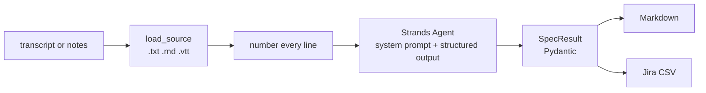

# forge-agents foundation + reference agent — implementation plan

> **For agentic workers:** REQUIRED SUB-SKILL: Use superpowers:subagent-driven-development (recommended) or superpowers:executing-plans to implement this plan task-by-task. Steps use checkbox (`- [ ]`) syntax for tracking.

**Goal:** Stand up the open-source `wexlai/forge-agents` monorepo (governance, repo tooling, CI, Renovate, agent template) and build the first agent, `forge-spec-strands-python`, end to end.

**Architecture:** Each `forge-*` folder is a self-contained agent described by an `agent.yaml` manifest. One stdlib-plus-PyYAML script (`tools/forge_repo.py`) validates folders, generates the README agent table, computes the CI matrix and lists stale folders; GitHub Actions workflows call it. The reference agent is a Strands Agents (Python) CLI that returns a typed Pydantic `SpecResult` via structured output and renders it to Markdown or Jira CSV.

**Tech Stack:** Python 3.12, uv, PyYAML, pytest, Strands Agents SDK 1.59 (`strands-agents[openai,anthropic]`), python-dotenv, GitHub Actions, Renovate, gitleaks, actionlint.

**Spec:** `docs/superpowers/specs/2026-10-12-forge-agents-repo-design.md`

## Global Constraints

- Licence Apache-2.0; `NOTICE` reads "Copyright 2026 WeXL". No per-file licence headers.
- Security and conduct contact: bharat@wexl.in.
- Folder name: `forge-<id>-<framework>` or `forge-<id>-<framework>-<language>`; language part optional; lowercase, hyphenated.
- README headings, in order: `What it does`, `Quick start`, `Configuration`, `How it works`, `Examples`, `Limitations`.
- `.env.example` sets `MODEL_PROVIDER` (= `providers[0]`) and `MODEL_ID`; shows at least one alternative provider commented out.
- No code shared between agent folders; no cross-folder imports.
- Never commit `.env`, secrets or real customer data.
- Reference agent defaults: `MODEL_PROVIDER=openai`, `MODEL_ID=gpt-5`; alternatives `anthropic` (`claude-sonnet-5-5`) and `bedrock`.
- Tests must pass with no API key and no network.
- Skills/steering content does not belong in this repo (it goes to `forge-skills`).
- Website copy rules apply to README prose: no invented numbers, Forge is "how we build", never "a platform".
- Do not push to GitHub; a person does that.

## Review Focus

1. Input file missing, a directory, or an unsupported type such as `.docx` → `forge-spec` exits 2 with one clear line, no traceback (Task 7 `test_inputs.py`, Task 11 `test_cli.py`).
2. Chosen provider's API key missing or blank, or an unknown `MODEL_PROVIDER` → exit 2 before any network call, naming the variable to set (Task 8 `test_providers.py`, Task 11 `test_cli.py`).
3. Empty, whitespace-only, non-UTF-8, BOM-prefixed or CRLF input files → clear error or clean text (Task 7 `test_inputs.py`).
4. Model output containing commas, quotes, pipes or newlines → Jira CSV still parses back to the same values (Task 10 `test_render.py`).
5. Malformed `agent.yaml` (invalid YAML, list at the root, unquoted version number) → `validate` reports it as a normal error line, never a traceback (Task 2 `test_validate.py`).

---

## File map

```
forge-agents/
├── README.md                          Task 1 (skeleton), Task 3/12 (index)
├── LICENSE, NOTICE, CODE_OF_CONDUCT.md, SECURITY.md, CONTRIBUTING.md, .gitignore   Task 1
├── .github/CODEOWNERS, PULL_REQUEST_TEMPLATE.md, ISSUE_TEMPLATE/*                  Task 1
├── .github/workflows/{validate,ci,live-examples,staleness}.yml                     Task 6
├── renovate.json                                                                   Task 6
├── tools/forge_repo.py                Tasks 2–4
├── tools/tests/conftest.py            Task 2
├── tools/tests/agent_fixtures.py      Task 2
├── tools/tests/test_validate.py       Task 2
├── tools/tests/test_index.py          Task 3
├── tools/tests/test_matrix_stale.py   Task 4
├── tools/tests/test_template.py       Task 5
├── templates/agent/…                  Task 5
└── forge-spec-strands-python/
    ├── pyproject.toml, uv.lock        Task 7
    ├── src/forge_spec/__init__.py     Task 7
    ├── src/forge_spec/models.py       Task 7   typed result
    ├── src/forge_spec/inputs.py       Task 7   load .txt/.md/.vtt
    ├── src/forge_spec/providers.py    Task 8   env → Strands model
    ├── src/forge_spec/prompt.py       Task 9   system prompt + user prompt
    ├── src/forge_spec/agent.py        Task 9   generate_spec()
    ├── src/forge_spec/render.py       Task 10  Markdown + Jira CSV
    ├── src/forge_spec/cli.py          Task 11  forge-spec command
    ├── tests/conftest.py              Task 7 (sample), Task 9 (StubModel)
    ├── tests/test_*.py                Tasks 7–11
    ├── agent.yaml, README.md, .env.example, examples/   Task 12
```

---

### Task 1: Repo foundation and governance files

**Files:**
- Delete: `forge-spec-strands-typescript/` (empty)
- Create: `LICENSE`, `NOTICE`, `CODE_OF_CONDUCT.md`, `SECURITY.md`, `CONTRIBUTING.md`, `.gitignore`, `README.md`, `.github/CODEOWNERS`, `.github/PULL_REQUEST_TEMPLATE.md`, `.github/ISSUE_TEMPLATE/bug_report.md`, `.github/ISSUE_TEMPLATE/new_agent.md`, `.github/ISSUE_TEMPLATE/config.yml`

**Interfaces:**
- Produces: `README.md` containing the markers `<!-- agents:start -->` and `<!-- agents:end -->` (used by Task 3).

- [ ] **Step 1: Remove the empty TypeScript folder**

```bash
rmdir forge-spec-strands-typescript
```

- [ ] **Step 2: Fetch the Apache-2.0 and Contributor Covenant texts**

```bash
curl -sSfL https://www.apache.org/licenses/LICENSE-2.0.txt -o LICENSE
curl -sSfL https://www.contributor-covenant.org/version/2/1/code_of_conduct/code_of_conduct.md -o CODE_OF_CONDUCT.md
sed -i '' 's/\[INSERT CONTACT METHOD\]/bharat@wexl.in/' CODE_OF_CONDUCT.md
grep -c "Apache License" LICENSE        # expect ≥ 1
grep -c "bharat@wexl.in" CODE_OF_CONDUCT.md   # expect 1
grep -c "INSERT" CODE_OF_CONDUCT.md     # expect 0
```

If the Contributor Covenant URL fails, use `https://raw.githubusercontent.com/EthicalSource/contributor_covenant/release/content/version/2/1/code_of_conduct.md` and apply the same `sed`.

- [ ] **Step 3: Write `NOTICE`**

```
Forge agents
Copyright 2026 WeXL

This product includes software developed at WeXL (https://wexlai.com).
```

- [ ] **Step 4: Write `.gitignore`**

```gitignore
# Secrets: never commit a real .env
.env
.env.*
!.env.example

# Python
__pycache__/
*.py[cod]
.venv/
.pytest_cache/
.ruff_cache/
*.egg-info/

# Node
node_modules/

# JVM
target/
build/
.gradle/

# Build output
dist/

# Editors and OS
.idea/
.vscode/
.DS_Store
```

- [ ] **Step 5: Write `SECURITY.md`**

```markdown
# Security policy

## Reporting a vulnerability

Please report security problems privately. Do not open a public issue.

- Use GitHub's private vulnerability reporting: **Security → Report a vulnerability** on this repository, or
- email **bharat@wexl.in**.

Include the agent folder, what you found, and how to reproduce it. We will acknowledge your report within five working days and keep you informed until it is fixed.

## Scope

Every `forge-*` folder in this repository is in scope. Model providers' own services are not; report those to the provider.

## Secrets

Agents read API keys from environment variables or a local `.env` file, which is git-ignored. If you find a committed key, report it as above; we will revoke it.
```

- [ ] **Step 6: Write `CONTRIBUTING.md`**

````markdown
# Contributing

Each `forge-*` folder is one agent built on one framework. Folders do not share code, so a change usually touches one folder.

## Add an agent

1. Pick a folder name: `forge-<id>-<framework>` or `forge-<id>-<framework>-<language>`, lowercase with hyphens. `<id>` is the agent's catalog id (`spec`, `review`, `test`, …). The language part is optional.
2. Copy the template and fill in its placeholders:

   ```bash
   cp -R templates/agent forge-<id>-<framework>-<language>
   grep -rl "__[A-Z]*__" forge-<id>-<framework>-<language>   # every file listed needs editing
   ```

3. Fill in `agent.yaml` (see "The manifest" below), build the agent, and write tests that run without an API key: replace the model with a stub.
4. Commit at least one real example pair in `examples/`: `<name>.input.<ext>` and the `<name>.output.<ext>` the agent actually produced.
5. Check the folder and regenerate the agent table in the root README:

   ```bash
   uv run tools/forge_repo.py validate
   uv run tools/forge_repo.py index
   ```

6. Run the folder's own `commands.test`, then open a pull request.

If your framework or language is new to the repo, add it to `FRAMEWORKS` or `LANGUAGES` in `tools/forge_repo.py` in the same pull request.

## Folder standard

Every agent folder contains:

| Item | Rule |
| --- | --- |
| `agent.yaml` | The manifest. |
| `README.md` | These `##` headings, in order: What it does, Quick start, Configuration, How it works, Examples, Limitations. |
| `.env.example` | Every variable the agent reads, with working defaults. `MODEL_PROVIDER` must equal the first entry of `providers`. Show at least one alternative provider, commented out. |
| `examples/` | At least one input/output pair, produced by a real run. |
| Tests | Wherever the language normally puts them. They must pass with no API key and no network. |
| Build file | `pyproject.toml` (uv), `package.json`, `pom.xml` or `build.gradle(.kts)`, with a lockfile. |

Never commit `.env`, secrets or real customer data.

## The manifest

```yaml
id: spec
name: Forge Spec
framework: strands
language: python
status: beta            # experimental | beta | live | deprecated
description: "One line, at most 120 characters"
catalog: https://wexlai.com/forge/forge-spec   # optional
providers: [openai, anthropic, bedrock]       # first one is the .env.example default
commands:
  setup: uv sync
  test: uv run pytest
  example: uv run forge-spec examples/refinement-call.input.txt
runtime:
  python: "3.12"        # exactly one of python, node, java, go, dotnet; quote the version
maintainers: ["@wexlai/forge"]
```

## Sign your commits (DCO)

We use the [Developer Certificate of Origin](https://developercertificate.org/). Sign off every commit:

```bash
git commit -s -m "your message"
```

## For maintainers

- Branch protection on `main`: require a pull request, and require the `validate` and `ci` checks to pass.
- Install the [DCO GitHub App](https://github.com/apps/dco) on the repository.
- Install the [Renovate GitHub App](https://github.com/apps/renovate) on the repository.
- Repository secrets for the weekly live run: `OPENAI_API_KEY`, `ANTHROPIC_API_KEY`, and optionally `AWS_ACCESS_KEY_ID` / `AWS_SECRET_ACCESS_KEY` (with repository variable `AWS_REGION`).
- `CODEOWNERS` names the `@wexlai/forge` team; create it in the organisation if it does not exist.
````

- [ ] **Step 7: Write `README.md` (skeleton; the table is generated in Task 3)**

````markdown
# Forge agents

[](https://github.com/wexlai/forge-agents/actions/workflows/validate.yml)
[](https://github.com/wexlai/forge-agents/actions/workflows/ci.yml)
[](LICENSE)

Open-source agents for the software development lifecycle, built by [WeXL](https://wexlai.com) on different agent frameworks: Strands, CrewAI, Spring AI, Embabel and others. They are the runnable source behind the [Forge Catalog](https://wexlai.com/forge).

Each folder is one agent built on one framework. Folders share no code: copy one out of this repository and it still works.

## Agents

<!-- agents:start -->
<!-- agents:end -->

## Run an agent

Every folder works the same way:

```bash
cd forge-spec-strands-python
cp .env.example .env        # then add your API key
```

Then run the `setup` and `example` commands from the folder's `agent.yaml`. The folder's README explains its options and which model providers it supports.

## Folder names

`forge-<agent>-<framework>[-<language>]`, for example `forge-spec-strands-python`. The same agent can appear more than once, built on different frameworks.

## Contributing

See [CONTRIBUTING.md](CONTRIBUTING.md). Report security problems privately, as described in [SECURITY.md](SECURITY.md).

## Licence

[Apache-2.0](LICENSE). Copyright 2026 WeXL.
````

- [ ] **Step 8: Write the `.github` files**

`.github/CODEOWNERS`:

```
* @wexlai/forge
```

`.github/PULL_REQUEST_TEMPLATE.md`:

```markdown
## What changed

<!-- One or two sentences. Name the agent folder(s). -->

## Checklist

- [ ] `uv run tools/forge_repo.py validate` passes
- [ ] `uv run tools/forge_repo.py index` run, README table committed
- [ ] The folder's own tests pass without an API key
- [ ] Example output in `examples/` comes from a real run
- [ ] No `.env`, secrets or customer data committed
- [ ] Commits are signed off (`git commit -s`)
```

`.github/ISSUE_TEMPLATE/bug_report.md`:

```markdown
---
name: Bug report
about: An agent did something wrong or failed to run
labels: bug
---

**Agent folder:** forge-…

**What you ran** (command and provider/model from your `.env`, without keys):

**What happened:**

**What you expected:**

**Input** (a minimal, shareable input that shows the problem; no customer data):
```

`.github/ISSUE_TEMPLATE/new_agent.md`:

```markdown
---
name: New agent proposal
about: Propose an agent, or an existing agent on a new framework
labels: new-agent
---

**Proposed folder name:** forge-<id>-<framework>[-<language>]

**What it does** (one line):

**Input and output:**

**Why this framework:**
```

`.github/ISSUE_TEMPLATE/config.yml`:

```yaml
blank_issues_enabled: true
contact_links:
  - name: Report a security problem
    url: https://github.com/wexlai/forge-agents/security/advisories/new
    about: Please report vulnerabilities privately.
```

- [ ] **Step 9: Verify and commit**

```bash
ls forge-spec-strands-typescript 2>&1 | grep -c "No such file"   # expect 1
grep -c "agents:start" README.md                                  # expect 1
git add -A
git commit -s -m "chore: add licence, governance files and README skeleton"
```

---

### Task 2: `tools/forge_repo.py` — manifest and folder validation

**Files:**
- Create: `tools/forge_repo.py`
- Create: `tools/tests/conftest.py`, `tools/tests/agent_fixtures.py`, `tools/tests/test_validate.py`

**Interfaces:**
- Produces (used by Tasks 3–6):
  - constants `FRAMEWORKS`, `LANGUAGES`, `STATUSES`, `PROVIDERS`, `RUNTIMES`, `COMMANDS`, `README_HEADINGS`, `INDEX_START`, `INDEX_END`, `SHARED_PREFIXES`, `ROOT`
  - `agent_folders(root: Path) -> list[Path]`
  - `load_manifest(folder: Path) -> dict` (raises `ValueError`)
  - `check_manifest(m: dict) -> list[str]`
  - `check_folder(folder: Path) -> list[str]`
  - `validate(root: Path, names: list[str] | None = None) -> list[str]` (each entry `"<folder>: <message>"`)
  - `main(argv: list[str] | None = None) -> int` with hidden global `--root PATH`
- Test helper `write_agent(root, folder=..., manifest=None, drop=(), readme=README, env=ENV, examples=(...)) -> Path` in `tools/tests/agent_fixtures.py`.

- [ ] **Step 1: Write the test helpers**

`tools/tests/conftest.py`:

```python
import sys
from pathlib import Path

sys.path.insert(0, str(Path(__file__).resolve().parent.parent))
```

`tools/tests/agent_fixtures.py`:

```python
"""Builds agent folders on disk for tests."""

from pathlib import Path

import yaml

HEADINGS = ("What it does", "Quick start", "Configuration", "How it works", "Examples", "Limitations")
README = "# Forge Spec\n\n" + "".join(f"## {h}\n\nText.\n\n" for h in HEADINGS)
ENV = "MODEL_PROVIDER=openai\nMODEL_ID=gpt-5\nOPENAI_API_KEY=\n# MODEL_PROVIDER=anthropic\n"

VALID_MANIFEST = {
    "id": "spec",
    "name": "Forge Spec",
    "framework": "strands",
    "language": "python",
    "status": "beta",
    "description": "Turns notes into stories",
    "catalog": "https://wexlai.com/forge/forge-spec",
    "providers": ["openai", "anthropic"],
    "commands": {"setup": "uv sync", "test": "uv run pytest", "example": "uv run forge-spec examples/a.input.txt"},
    "runtime": {"python": "3.12"},
    "maintainers": ["@wexlai/forge"],
}


def write_agent(
    root: Path,
    folder: str = "forge-spec-strands-python",
    manifest: dict | None = None,
    drop: tuple[str, ...] = (),
    readme: str | None = README,
    env: str | None = ENV,
    examples: tuple[str, ...] = ("demo.input.txt", "demo.output.md"),
) -> Path:
    d = root / folder
    (d / "examples").mkdir(parents=True)
    m = {**VALID_MANIFEST, **(manifest or {})}
    for key in drop:
        m.pop(key)
    (d / "agent.yaml").write_text(yaml.safe_dump(m, sort_keys=False), encoding="utf-8")
    if readme is not None:
        (d / "README.md").write_text(readme, encoding="utf-8")
    if env is not None:
        (d / ".env.example").write_text(env, encoding="utf-8")
    for name in examples:
        (d / "examples" / name).write_text("x", encoding="utf-8")
    return d
```

- [ ] **Step 2: Write the failing tests**

`tools/tests/test_validate.py`:

```python
import pytest

import forge_repo
from agent_fixtures import HEADINGS, README, write_agent

NAME = "forge-spec-strands-python"


def test_valid_folder_has_no_errors(tmp_path):
    write_agent(tmp_path)
    assert forge_repo.validate(tmp_path) == []


def test_language_part_of_folder_name_is_optional(tmp_path):
    write_agent(tmp_path, folder="forge-spec-strands")
    assert forge_repo.validate(tmp_path) == []


def test_folder_name_must_match_manifest(tmp_path):
    write_agent(tmp_path, folder="forge-spec-crewai-python")
    assert forge_repo.validate(tmp_path) == [
        "forge-spec-crewai-python: folder name must be one of: forge-spec-strands, forge-spec-strands-python"
    ]


def test_non_agent_folders_are_ignored(tmp_path):
    (tmp_path / "tools").mkdir()
    (tmp_path / "templates").mkdir()
    write_agent(tmp_path)
    assert forge_repo.validate(tmp_path) == []


def test_missing_key(tmp_path):
    write_agent(tmp_path, drop=("maintainers",))
    assert forge_repo.validate(tmp_path) == [f"{NAME}: agent.yaml: missing key 'maintainers'"]


@pytest.mark.parametrize(
    "override, message",
    [
        ({"framework": "crew-ai"}, "agent.yaml: unknown framework 'crew-ai' (add it to FRAMEWORKS in tools/forge_repo.py)"),
        ({"language": "rust"}, "agent.yaml: unknown language 'rust' (add it to LANGUAGES in tools/forge_repo.py)"),
        ({"status": "alpha"}, "agent.yaml: status must be one of: experimental, beta, live, deprecated"),
        ({"providers": []}, "agent.yaml: providers must be a non-empty list"),
        ({"providers": ["openai", "groq"]}, "agent.yaml: unknown provider 'groq'"),
        ({"runtime": {"python": 3.12}}, 'agent.yaml: runtime version must be a quoted string, e.g. "3.12"'),
        ({"runtime": {"python": "3.12", "node": "22"}}, "agent.yaml: runtime must have exactly one key"),
        ({"runtime": {"ruby": "3.3"}}, "agent.yaml: unknown runtime 'ruby'"),
        ({"commands": {"setup": "uv sync", "test": "uv run pytest"}}, "agent.yaml: commands.example must be a non-empty string"),
        ({"commands": "uv sync"}, "agent.yaml: commands must be a mapping"),
        ({"id": "Spec"}, "agent.yaml: id must be a lowercase slug like 'spec'"),
        ({"name": ""}, "agent.yaml: name must be a non-empty string"),
        ({"description": "x" * 121}, "agent.yaml: description must be at most 120 characters"),
        ({"catalog": "wexlai.com/forge"}, "agent.yaml: catalog must be an https:// URL"),
        ({"maintainers": []}, "agent.yaml: maintainers must be a non-empty list of GitHub users or teams"),
    ],
)
def test_manifest_rule(tmp_path, override, message):
    write_agent(tmp_path, manifest=override)
    assert f"{NAME}: {message}" in forge_repo.validate(tmp_path)


def test_catalog_is_optional(tmp_path):
    write_agent(tmp_path, drop=("catalog",))
    assert forge_repo.validate(tmp_path) == []


def test_missing_manifest(tmp_path):
    d = write_agent(tmp_path)
    (d / "agent.yaml").unlink()
    assert forge_repo.validate(tmp_path) == [f"{NAME}: agent.yaml is missing"]


def test_invalid_yaml_is_reported_not_raised(tmp_path):
    d = write_agent(tmp_path)
    (d / "agent.yaml").write_text("id: [unclosed\n", encoding="utf-8")
    errors = forge_repo.validate(tmp_path)
    assert len(errors) == 1
    assert errors[0].startswith(f"{NAME}: agent.yaml is not valid YAML")


def test_yaml_list_root_is_reported(tmp_path):
    d = write_agent(tmp_path)
    (d / "agent.yaml").write_text("- id\n- name\n", encoding="utf-8")
    assert forge_repo.validate(tmp_path) == [f"{NAME}: agent.yaml must be a mapping"]


def test_readme_missing(tmp_path):
    write_agent(tmp_path, readme=None)
    assert forge_repo.validate(tmp_path) == [f"{NAME}: README.md is missing"]


def test_readme_headings_out_of_order(tmp_path):
    swapped = ("Quick start", "What it does") + HEADINGS[2:]
    write_agent(tmp_path, readme="# X\n\n" + "".join(f"## {h}\n\n" for h in swapped))
    assert forge_repo.validate(tmp_path) == [
        f"{NAME}: README.md: needs these ## headings in order: "
        "What it does, Quick start, Configuration, How it works, Examples, Limitations"
    ]


def test_readme_extra_headings_are_allowed(tmp_path):
    write_agent(tmp_path, readme=README.replace("## Limitations", "## Troubleshooting\n\nText.\n\n## Limitations"))
    assert forge_repo.validate(tmp_path) == []


def test_env_example_missing(tmp_path):
    write_agent(tmp_path, env=None)
    assert forge_repo.validate(tmp_path) == [f"{NAME}: .env.example is missing"]


def test_env_example_needs_model_id(tmp_path):
    write_agent(tmp_path, env="MODEL_PROVIDER=openai\n")
    assert forge_repo.validate(tmp_path) == [f"{NAME}: .env.example: MODEL_ID must be set"]


def test_env_example_provider_must_match_manifest(tmp_path):
    write_agent(tmp_path, env="MODEL_PROVIDER=anthropic\nMODEL_ID=claude-sonnet-5-5\n")
    assert forge_repo.validate(tmp_path) == [
        f"{NAME}: .env.example: MODEL_PROVIDER is 'anthropic' but providers[0] in agent.yaml is 'openai'"
    ]


def test_env_example_ignores_comments_and_quotes(tmp_path):
    write_agent(tmp_path, env='# MODEL_PROVIDER=anthropic\nMODEL_PROVIDER="openai"\nMODEL_ID=gpt-5\n')
    assert forge_repo.validate(tmp_path) == []


@pytest.mark.parametrize(
    "examples",
    [(), ("demo.input.txt",), ("a.input.txt", "b.output.md"), ("demo.txt", "demo.md")],
)
def test_examples_need_a_matching_pair(tmp_path, examples):
    write_agent(tmp_path, examples=examples)
    assert forge_repo.validate(tmp_path) == [
        f"{NAME}: examples/ needs at least one <name>.input.<ext> and <name>.output.<ext> pair"
    ]


def test_validate_named_folders_only(tmp_path):
    write_agent(tmp_path)
    write_agent(tmp_path, folder="forge-test-strands-python", manifest={"id": "test"}, readme=None)
    assert forge_repo.validate(tmp_path, ["forge-spec-strands-python/"]) == []


def test_validate_unknown_folder(tmp_path):
    assert forge_repo.validate(tmp_path, ["forge-nope"]) == ["forge-nope: no such agent folder"]


def test_cli_validate_exit_codes(tmp_path, capsys):
    write_agent(tmp_path)
    assert forge_repo.main(["--root", str(tmp_path), "validate"]) == 0
    assert "ok" in capsys.readouterr().out
    write_agent(tmp_path, folder="forge-bad-strands", manifest={"id": "bad"}, env=None)
    assert forge_repo.main(["--root", str(tmp_path), "validate"]) == 1
    assert "forge-bad-strands: .env.example is missing" in capsys.readouterr().out
```

- [ ] **Step 3: Run the tests to see them fail**

Run: `uv run --python 3.12 --with pyyaml --with pytest pytest tools/tests -q`
Expected: collection error, `ModuleNotFoundError: No module named 'forge_repo'`.

- [ ] **Step 4: Write `tools/forge_repo.py` (validation part)**

```python
# /// script
# requires-python = ">=3.12"
# dependencies = ["pyyaml>=6"]
# ///
"""Repo tooling for forge-agents.

  validate [FOLDER ...]                       check agent folders against the folder standard
  index [--check]                             rewrite (or check) the agent table in README.md
  matrix [--changed-from REF | --agent NAME]  print the CI matrix as JSON
  stale [--days N]                            list agent folders with no commit in N days

Run with: uv run tools/forge_repo.py <command>
"""

from __future__ import annotations

import argparse
import re
import sys
from pathlib import Path

import yaml

ROOT = Path(__file__).resolve().parent.parent

FRAMEWORKS = frozenset(
    {
        "strands", "crewai", "spring-ai", "embabel", "langgraph", "autogen",
        "pydantic-ai", "openai-agents", "claude-agent-sdk", "mastra", "semantic-kernel", "adk",
    }
)
LANGUAGES = frozenset({"python", "typescript", "java", "kotlin", "go", "csharp"})
STATUSES = ("experimental", "beta", "live", "deprecated")
PROVIDERS = frozenset({"anthropic", "bedrock", "openai", "azure-openai", "vertex", "gemini", "ollama"})
RUNTIMES = frozenset({"python", "node", "java", "go", "dotnet"})
COMMANDS = ("setup", "test", "example")
REQUIRED_KEYS = (
    "id", "name", "framework", "language", "status", "description",
    "providers", "commands", "runtime", "maintainers",
)
README_HEADINGS = ("What it does", "Quick start", "Configuration", "How it works", "Examples", "Limitations")
MAX_DESCRIPTION = 120
INDEX_START = "<!-- agents:start -->"
INDEX_END = "<!-- agents:end -->"
SHARED_PREFIXES = ("tools/", "templates/", ".github/")

SLUG = re.compile(r"^[a-z0-9]+(?:-[a-z0-9]+)*$")
EXAMPLE_FILE = re.compile(r"^(?P<name>.+)\.(?P<kind>input|output)\.[^.]+$")
HEADING = re.compile(r"^## (.+?)\s*$", re.MULTILINE)


def agent_folders(root: Path) -> list[Path]:
    return sorted(p for p in root.iterdir() if p.is_dir() and p.name.startswith("forge-"))


def load_manifest(folder: Path) -> dict:
    path = folder / "agent.yaml"
    if not path.is_file():
        raise ValueError("agent.yaml is missing")
    try:
        data = yaml.safe_load(path.read_text(encoding="utf-8"))
    except yaml.YAMLError as exc:
        raise ValueError(f"agent.yaml is not valid YAML: {exc}") from exc
    if not isinstance(data, dict):
        raise ValueError("agent.yaml must be a mapping")
    return data


def _non_empty_str(value: object) -> bool:
    return isinstance(value, str) and bool(value.strip())


def check_manifest(m: dict) -> list[str]:
    errors = [f"agent.yaml: missing key '{k}'" for k in REQUIRED_KEYS if k not in m]
    if errors:
        return errors
    if not isinstance(m["id"], str) or not SLUG.match(m["id"]):
        errors.append("agent.yaml: id must be a lowercase slug like 'spec'")
    for key in ("name", "description"):
        if not _non_empty_str(m[key]):
            errors.append(f"agent.yaml: {key} must be a non-empty string")
    if isinstance(m["description"], str) and len(m["description"]) > MAX_DESCRIPTION:
        errors.append(f"agent.yaml: description must be at most {MAX_DESCRIPTION} characters")
    if m["framework"] not in FRAMEWORKS:
        errors.append(f"agent.yaml: unknown framework '{m['framework']}' (add it to FRAMEWORKS in tools/forge_repo.py)")
    if m["language"] not in LANGUAGES:
        errors.append(f"agent.yaml: unknown language '{m['language']}' (add it to LANGUAGES in tools/forge_repo.py)")
    if m["status"] not in STATUSES:
        errors.append(f"agent.yaml: status must be one of: {', '.join(STATUSES)}")
    providers = m["providers"]
    if not isinstance(providers, list) or not providers:
        errors.append("agent.yaml: providers must be a non-empty list")
    else:
        errors += [f"agent.yaml: unknown provider '{p}'" for p in providers if p not in PROVIDERS]
    commands = m["commands"]
    if not isinstance(commands, dict):
        errors.append("agent.yaml: commands must be a mapping")
    else:
        errors += [
            f"agent.yaml: commands.{c} must be a non-empty string" for c in COMMANDS if not _non_empty_str(commands.get(c))
        ]
    runtime = m["runtime"]
    if not isinstance(runtime, dict) or len(runtime) != 1:
        errors.append("agent.yaml: runtime must have exactly one key")
    else:
        kind, version = next(iter(runtime.items()))
        if kind not in RUNTIMES:
            errors.append(f"agent.yaml: unknown runtime '{kind}'")
        if not _non_empty_str(version):
            errors.append('agent.yaml: runtime version must be a quoted string, e.g. "3.12"')
    maintainers = m["maintainers"]
    if not isinstance(maintainers, list) or not maintainers or not all(_non_empty_str(x) for x in maintainers):
        errors.append("agent.yaml: maintainers must be a non-empty list of GitHub users or teams")
    if "catalog" in m and not (isinstance(m["catalog"], str) and m["catalog"].startswith("https://")):
        errors.append("agent.yaml: catalog must be an https:// URL")
    return errors


def read_env_example(path: Path) -> dict[str, str]:
    values: dict[str, str] = {}
    for raw in path.read_text(encoding="utf-8").splitlines():
        line = raw.strip()
        if not line or line.startswith("#") or "=" not in line:
            continue
        key, _, value = line.partition("=")
        values[key.strip()] = value.strip().strip('"').strip("'")
    return values


def has_example_pair(examples: Path) -> bool:
    if not examples.is_dir():
        return False
    kinds: dict[str, set[str]] = {}
    for path in examples.iterdir():
        match = EXAMPLE_FILE.match(path.name)
        if path.is_file() and match:
            kinds.setdefault(match["name"], set()).add(match["kind"])
    return any(k == {"input", "output"} for k in kinds.values())


def check_folder(folder: Path) -> list[str]:
    try:
        m = load_manifest(folder)
    except ValueError as exc:
        return [str(exc)]
    errors = check_manifest(m)
    if not errors:
        allowed = {f"forge-{m['id']}-{m['framework']}", f"forge-{m['id']}-{m['framework']}-{m['language']}"}
        if folder.name not in allowed:
            errors.append(f"folder name must be one of: {', '.join(sorted(allowed))}")

    readme = folder / "README.md"
    if not readme.is_file():
        errors.append("README.md is missing")
    else:
        found = iter(HEADING.findall(readme.read_text(encoding="utf-8")))
        if not all(h in found for h in README_HEADINGS):
            errors.append("README.md: needs these ## headings in order: " + ", ".join(README_HEADINGS))

    env_example = folder / ".env.example"
    if not env_example.is_file():
        errors.append(".env.example is missing")
    else:
        values = read_env_example(env_example)
        for key in ("MODEL_PROVIDER", "MODEL_ID"):
            if not values.get(key):
                errors.append(f".env.example: {key} must be set")
        providers = m.get("providers")
        provider = values.get("MODEL_PROVIDER")
        if provider and isinstance(providers, list) and providers and provider != providers[0]:
            errors.append(
                f".env.example: MODEL_PROVIDER is '{provider}' but providers[0] in agent.yaml is '{providers[0]}'"
            )

    if not has_example_pair(folder / "examples"):
        errors.append("examples/ needs at least one <name>.input.<ext> and <name>.output.<ext> pair")
    return errors


def validate(root: Path, names: list[str] | None = None) -> list[str]:
    folders = agent_folders(root)
    unknown: list[str] = []
    if names:
        by_name = {f.name: f for f in folders}
        wanted = [n.rstrip("/") for n in names]
        unknown = [f"{n}: no such agent folder" for n in wanted if n not in by_name]
        folders = [by_name[n] for n in wanted if n in by_name]
    return unknown + [f"{f.name}: {e}" for f in folders for e in check_folder(f)]


def main(argv: list[str] | None = None) -> int:
    parser = argparse.ArgumentParser(
        prog="forge_repo", description=__doc__, formatter_class=argparse.RawDescriptionHelpFormatter
    )
    parser.add_argument("--root", type=Path, default=ROOT, help=argparse.SUPPRESS)
    sub = parser.add_subparsers(dest="command", required=True)
    p_validate = sub.add_parser("validate", help="check agent folders")
    p_validate.add_argument("folders", nargs="*")
    args = parser.parse_args(argv)
    root = args.root.resolve()

    if args.command == "validate":
        errors = validate(root, args.folders)
        for error in errors:
            print(error)
        if not errors:
            print("ok: all agent folders are valid")
        return 1 if errors else 0
    return 2


if __name__ == "__main__":
    sys.exit(main())
```

- [ ] **Step 5: Run the tests to see them pass**

Run: `uv run --python 3.12 --with pyyaml --with pytest pytest tools/tests -q`
Expected: all tests in `test_validate.py` pass.

Also run: `uv run tools/forge_repo.py validate`
Expected: exit 1 with exactly one line, `forge-spec-strands-python: agent.yaml is missing`. The folder is still empty; Task 12 fills it.

- [ ] **Step 6: Commit**

```bash
git add tools/
git commit -s -m "feat(tools): validate agent folders against the folder standard"
```

---

### Task 3: `tools/forge_repo.py` — README agent index

**Files:**
- Modify: `tools/forge_repo.py`
- Create: `tools/tests/test_index.py`

**Interfaces:**
- Consumes: `agent_folders`, `load_manifest`, `validate`, `INDEX_START`, `INDEX_END` (Task 2).
- Produces: `render_index(root: Path) -> str`, `replace_index(readme_text: str, table: str) -> str` (raises `ValueError`), `update_index(root: Path, check: bool = False) -> bool` (True when the README was already current); CLI `index [--check]`.

- [ ] **Step 1: Write the failing tests**

`tools/tests/test_index.py`:

```python
import pytest

import forge_repo
from agent_fixtures import write_agent

README = "# Forge agents\n\nIntro.\n\n<!-- agents:start -->\nold table\n<!-- agents:end -->\n\n## After\n"


def test_render_index_sorts_by_id_then_folder_and_escapes(tmp_path):
    write_agent(tmp_path, folder="forge-test-strands-python", manifest={"id": "test", "name": "Forge Test"})
    write_agent(tmp_path, folder="forge-spec-strands-python", manifest={"description": "Notes | stories"})
    write_agent(tmp_path, folder="forge-spec-strands", manifest={"status": "deprecated"})
    assert forge_repo.render_index(tmp_path) == "\n".join(
        [
            "| Agent | Framework | Language | Status | Description |",
            "| --- | --- | --- | --- | --- |",
            "| [Forge Spec](forge-spec-strands/) | strands | python | deprecated | Turns notes into stories |",
            "| [Forge Spec](forge-spec-strands-python/) | strands | python | beta | Notes \\| stories |",
            "| [Forge Test](forge-test-strands-python/) | strands | python | beta | Turns notes into stories |",
        ]
    )


def test_render_index_with_no_agents(tmp_path):
    assert forge_repo.render_index(tmp_path).endswith("| _No agents yet_ | | | | |")


def test_replace_index_keeps_surrounding_text():
    out = forge_repo.replace_index(README, "TABLE")
    assert out == "# Forge agents\n\nIntro.\n\n<!-- agents:start -->\nTABLE\n<!-- agents:end -->\n\n## After\n"


def test_replace_index_needs_markers():
    with pytest.raises(ValueError, match="agents:start"):
        forge_repo.replace_index("# no markers\n", "TABLE")


def test_update_index_writes_then_reports_current(tmp_path):
    write_agent(tmp_path)
    (tmp_path / "README.md").write_text(README, encoding="utf-8")
    assert forge_repo.update_index(tmp_path, check=True) is False
    assert "old table" in (tmp_path / "README.md").read_text(encoding="utf-8")  # check mode does not write
    assert forge_repo.update_index(tmp_path) is False
    assert "[Forge Spec](forge-spec-strands-python/)" in (tmp_path / "README.md").read_text(encoding="utf-8")
    assert forge_repo.update_index(tmp_path, check=True) is True


def test_cli_index_check_fails_when_stale(tmp_path, capsys):
    write_agent(tmp_path)
    (tmp_path / "README.md").write_text(README, encoding="utf-8")
    assert forge_repo.main(["--root", str(tmp_path), "index", "--check"]) == 1
    assert "out of date" in capsys.readouterr().err
    assert forge_repo.main(["--root", str(tmp_path), "index"]) == 0
    assert forge_repo.main(["--root", str(tmp_path), "index", "--check"]) == 0


def test_cli_index_refuses_invalid_folders(tmp_path, capsys):
    write_agent(tmp_path, env=None)
    (tmp_path / "README.md").write_text(README, encoding="utf-8")
    assert forge_repo.main(["--root", str(tmp_path), "index"]) == 1
    assert ".env.example is missing" in capsys.readouterr().err


def test_cli_index_reports_missing_markers(tmp_path, capsys):
    write_agent(tmp_path)
    (tmp_path / "README.md").write_text("# no markers\n", encoding="utf-8")
    assert forge_repo.main(["--root", str(tmp_path), "index"]) == 1
    assert "agents:start" in capsys.readouterr().err
```

- [ ] **Step 2: Run the tests to see them fail**

Run: `uv run --python 3.12 --with pyyaml --with pytest pytest tools/tests/test_index.py -q`
Expected: FAIL with `AttributeError: module 'forge_repo' has no attribute 'render_index'`.

- [ ] **Step 3: Add the index functions** (insert after `validate()` in `tools/forge_repo.py`)

```python
def _cell(value: object) -> str:
    return str(value).replace("|", "\\|").replace("\n", " ")


def render_index(root: Path) -> str:
    rows = []
    for folder in agent_folders(root):
        m = load_manifest(folder)
        rows.append((m["id"], folder.name, m))
    rows.sort(key=lambda row: (row[0], row[1]))
    lines = [
        "| Agent | Framework | Language | Status | Description |",
        "| --- | --- | --- | --- | --- |",
    ]
    for _, name, m in rows:
        lines.append(
            f"| [{_cell(m['name'])}]({name}/) | {m['framework']} | {m['language']} | {m['status']} | {_cell(m['description'])} |"
        )
    if not rows:
        lines.append("| _No agents yet_ | | | | |")
    return "\n".join(lines)


def replace_index(readme_text: str, table: str) -> str:
    start = readme_text.find(INDEX_START)
    end = readme_text.find(INDEX_END)
    if start == -1 or end == -1 or end < start:
        raise ValueError(f"README.md must contain {INDEX_START} followed by {INDEX_END}")
    return readme_text[: start + len(INDEX_START)] + "\n" + table + "\n" + readme_text[end:]


def update_index(root: Path, check: bool = False) -> bool:
    readme = root / "README.md"
    text = readme.read_text(encoding="utf-8")
    new = replace_index(text, render_index(root))
    if new == text:
        return True
    if not check:
        readme.write_text(new, encoding="utf-8")
    return False
```

In `main()`, after the `p_validate` lines, add:

```python
    p_index = sub.add_parser("index", help="rewrite the agent table in README.md")
    p_index.add_argument("--check", action="store_true", help="fail if the table is out of date; do not write")
```

and before the final `return 2`, add:

```python
    if args.command == "index":
        errors = validate(root)
        if errors:
            for error in errors:
                print(error, file=sys.stderr)
            print("fix these before regenerating the index", file=sys.stderr)
            return 1
        try:
            current = update_index(root, check=args.check)
        except ValueError as exc:
            print(exc, file=sys.stderr)
            return 1
        if args.check and not current:
            print("README.md agent table is out of date; run: uv run tools/forge_repo.py index", file=sys.stderr)
            return 1
        return 0
```

- [ ] **Step 4: Run the tests to see them pass**

Run: `uv run --python 3.12 --with pyyaml --with pytest pytest tools/tests -q`
Expected: all pass.

- [ ] **Step 5: Commit**

```bash
git add tools/
git commit -s -m "feat(tools): generate the agent table in the root README"
```

---

### Task 4: `tools/forge_repo.py` — CI matrix and staleness

**Files:**
- Modify: `tools/forge_repo.py`
- Create: `tools/tests/test_matrix_stale.py`

**Interfaces:**
- Consumes: `agent_folders`, `load_manifest`, `check_manifest`, `COMMANDS`, `SHARED_PREFIXES` (Task 2).
- Produces:
  - `select_folders(folders: list[Path], changed: list[str] | None) -> list[Path]`
  - `git_changed_files(root: Path, ref: str) -> list[str]` (raises `ValueError`)
  - `matrix(root: Path, changed_from: str | None = None, agent: str | None = None, skip_deprecated: bool = False) -> list[dict]`; each dict has keys `folder`, `runtime`, `version`, `setup`, `test`, `example` (used by Task 6 workflows as `matrix.<key>`)
  - `last_commit_time(root: Path, folder: Path) -> int | None`
  - `stale_folders(root: Path, days: int, now: float | None = None) -> list[str]`
  - CLI `matrix [--changed-from REF | --agent NAME] [--skip-deprecated]` prints a JSON list on one line; CLI `stale [--days N]` prints one folder per line.

- [ ] **Step 1: Write the failing tests**

`tools/tests/test_matrix_stale.py`:

```python
import json
import os
import subprocess
from datetime import datetime, timezone
from pathlib import Path

import forge_repo
from agent_fixtures import write_agent


def git(root: Path, *args: str, date: str | None = None) -> None:
    env = {
        **os.environ,
        "GIT_AUTHOR_NAME": "t", "GIT_AUTHOR_EMAIL": "t@example.com",
        "GIT_COMMITTER_NAME": "t", "GIT_COMMITTER_EMAIL": "t@example.com",
    }
    if date:
        env |= {"GIT_AUTHOR_DATE": date, "GIT_COMMITTER_DATE": date}
    subprocess.run(["git", "-c", "commit.gpgsign=false", *args], cwd=root, env=env, check=True, capture_output=True)


def three_agents(root: Path) -> None:
    write_agent(root)
    write_agent(root, folder="forge-test-strands-python", manifest={"id": "test"})
    write_agent(root, folder="forge-review-strands-python", manifest={"id": "review", "status": "deprecated"})


def test_select_folders_rules():
    folders = [Path("forge-a-strands"), Path("forge-b-strands")]
    assert forge_repo.select_folders(folders, None) == folders
    assert forge_repo.select_folders(folders, ["forge-b-strands/src/x.py"]) == [Path("forge-b-strands")]
    assert forge_repo.select_folders(folders, ["tools/forge_repo.py"]) == folders
    assert forge_repo.select_folders(folders, [".github/workflows/ci.yml"]) == folders
    assert forge_repo.select_folders(folders, ["templates/agent/README.md"]) == folders
    assert forge_repo.select_folders(folders, ["README.md", "docs/x.md"]) == []


def test_matrix_entries(tmp_path):
    write_agent(tmp_path)
    assert forge_repo.matrix(tmp_path) == [
        {
            "folder": "forge-spec-strands-python",
            "runtime": "python",
            "version": "3.12",
            "setup": "uv sync",
            "test": "uv run pytest",
            "example": "uv run forge-spec examples/a.input.txt",
        }
    ]


def test_matrix_skip_deprecated_and_agent_filter(tmp_path):
    three_agents(tmp_path)
    names = [e["folder"] for e in forge_repo.matrix(tmp_path, skip_deprecated=True)]
    assert names == ["forge-spec-strands-python", "forge-test-strands-python"]
    assert [e["folder"] for e in forge_repo.matrix(tmp_path, agent="forge-test-strands-python/")] == [
        "forge-test-strands-python"
    ]


def test_matrix_skips_invalid_manifest(tmp_path, capsys):
    write_agent(tmp_path)
    write_agent(tmp_path, folder="forge-bad-strands", manifest={"id": "bad", "runtime": {"python": 3.12}})
    assert [e["folder"] for e in forge_repo.matrix(tmp_path)] == ["forge-spec-strands-python"]
    assert "forge-bad-strands: skipped" in capsys.readouterr().err


def test_cli_matrix_changed_from_git(tmp_path, capsys):
    git(tmp_path, "init", "-b", "main")
    three_agents(tmp_path)
    git(tmp_path, "add", "-A")
    git(tmp_path, "commit", "-m", "one")
    (tmp_path / "forge-test-strands-python" / "examples" / "demo.input.txt").write_text("changed", encoding="utf-8")
    git(tmp_path, "commit", "-am", "two")
    assert forge_repo.main(["--root", str(tmp_path), "matrix", "--changed-from", "HEAD~1"]) == 0
    out = capsys.readouterr().out.strip()
    assert "\n" not in out
    assert [e["folder"] for e in json.loads(out)] == ["forge-test-strands-python"]


def test_cli_matrix_unknown_agent(tmp_path, capsys):
    assert forge_repo.main(["--root", str(tmp_path), "matrix", "--agent", "forge-nope"]) == 1
    assert "no such agent folder" in capsys.readouterr().err


def test_cli_matrix_bad_ref(tmp_path, capsys):
    git(tmp_path, "init", "-b", "main")
    write_agent(tmp_path)
    git(tmp_path, "add", "-A")
    git(tmp_path, "commit", "-m", "one")
    assert forge_repo.main(["--root", str(tmp_path), "matrix", "--changed-from", "no-such-ref"]) == 1
    assert "git diff failed" in capsys.readouterr().err


def test_stale_folders(tmp_path, capsys):
    git(tmp_path, "init", "-b", "main")
    three_agents(tmp_path)
    git(tmp_path, "add", "forge-spec-strands-python", "forge-review-strands-python")
    git(tmp_path, "commit", "-m", "old", date="2026-01-01T00:00:00+00:00")
    git(tmp_path, "add", "forge-test-strands-python")
    git(tmp_path, "commit", "-m", "new", date="2026-10-01T00:00:00+00:00")
    write_agent(tmp_path, folder="forge-data-strands-python", manifest={"id": "data"})  # never committed
    now = datetime(2026, 10, 12, tzinfo=timezone.utc).timestamp()
    assert forge_repo.stale_folders(tmp_path, days=120, now=now) == ["forge-spec-strands-python"]
    assert forge_repo.main(["--root", str(tmp_path), "stale", "--days", "100000"]) == 0
    assert capsys.readouterr().out == ""
```

- [ ] **Step 2: Run the tests to see them fail**

Run: `uv run --python 3.12 --with pyyaml --with pytest pytest tools/tests/test_matrix_stale.py -q`
Expected: FAIL with `AttributeError: module 'forge_repo' has no attribute 'select_folders'`.

- [ ] **Step 3: Add the matrix and stale functions**

Add `import json`, `import subprocess`, `import time` to the imports at the top of `tools/forge_repo.py`. Insert after `update_index()`:

```python
def select_folders(folders: list[Path], changed: list[str] | None) -> list[Path]:
    if changed is None or any(path.startswith(SHARED_PREFIXES) for path in changed):
        return folders
    touched = {path.split("/", 1)[0] for path in changed}
    return [f for f in folders if f.name in touched]


def git_changed_files(root: Path, ref: str) -> list[str]:
    result = subprocess.run(
        ["git", "diff", "--name-only", f"{ref}...HEAD"], cwd=root, capture_output=True, text=True
    )
    if result.returncode != 0:
        raise ValueError(f"git diff failed for '{ref}': {result.stderr.strip()}")
    return [line for line in result.stdout.splitlines() if line]


def matrix(
    root: Path, changed_from: str | None = None, agent: str | None = None, skip_deprecated: bool = False
) -> list[dict]:
    folders = agent_folders(root)
    if agent is not None:
        name = agent.rstrip("/")
        folders = [f for f in folders if f.name == name]
        if not folders:
            raise ValueError(f"{name}: no such agent folder")
    elif changed_from is not None:
        folders = select_folders(folders, git_changed_files(root, changed_from))
    entries = []
    for folder in folders:
        try:
            m = load_manifest(folder)
        except ValueError as exc:
            print(f"{folder.name}: skipped: {exc}", file=sys.stderr)
            continue
        if check_manifest(m):
            print(f"{folder.name}: skipped: invalid agent.yaml (run validate)", file=sys.stderr)
            continue
        if skip_deprecated and m["status"] == "deprecated":
            continue
        kind, version = next(iter(m["runtime"].items()))
        entries.append(
            {"folder": folder.name, "runtime": kind, "version": version, **{c: m["commands"][c] for c in COMMANDS}}
        )
    return entries


def last_commit_time(root: Path, folder: Path) -> int | None:
    result = subprocess.run(
        ["git", "log", "-1", "--format=%ct", "--", folder.name], cwd=root, capture_output=True, text=True
    )
    out = result.stdout.strip()
    return int(out) if result.returncode == 0 and out else None


def stale_folders(root: Path, days: int, now: float | None = None) -> list[str]:
    cutoff = (time.time() if now is None else now) - days * 86400
    stale = []
    for folder in agent_folders(root):
        try:
            if load_manifest(folder).get("status") == "deprecated":
                continue
        except ValueError:
            pass
        committed = last_commit_time(root, folder)
        if committed is not None and committed < cutoff:
            stale.append(folder.name)
    return stale
```

In `main()`, add the parsers after `p_index`:

```python
    p_matrix = sub.add_parser("matrix", help="print the CI matrix as JSON")
    group = p_matrix.add_mutually_exclusive_group()
    group.add_argument("--changed-from", metavar="REF", help="only folders changed since REF")
    group.add_argument("--agent", metavar="NAME", help="only this agent folder")
    p_matrix.add_argument("--skip-deprecated", action="store_true")
    p_stale = sub.add_parser("stale", help="list agent folders with no recent commit")
    p_stale.add_argument("--days", type=int, default=120)
```

and the handlers before `return 2`:

```python
    if args.command == "matrix":
        try:
            entries = matrix(root, args.changed_from, args.agent, args.skip_deprecated)
        except ValueError as exc:
            print(exc, file=sys.stderr)
            return 1
        print(json.dumps(entries))
        return 0
    if args.command == "stale":
        for name in stale_folders(root, args.days):
            print(name)
        return 0
```

- [ ] **Step 4: Run the tests to see them pass**

Run: `uv run --python 3.12 --with pyyaml --with pytest pytest tools/tests -q`
Expected: all pass.

- [ ] **Step 5: Commit**

```bash
git add tools/
git commit -s -m "feat(tools): CI matrix and stale-folder detection"
```

---

### Task 5: Agent template

**Files:**
- Create: `templates/agent/agent.yaml`, `templates/agent/README.md`, `templates/agent/.env.example`, `templates/agent/examples/example.input.txt`, `templates/agent/examples/example.output.md`
- Create: `tools/tests/test_template.py`

**Interfaces:**
- Consumes: `forge_repo.validate` (Task 2).
- Produces: placeholders `__ID__`, `__NAME__`, `__FRAMEWORK__`, `__LANGUAGE__`, `__DESCRIPTION__` (documented in CONTRIBUTING, Task 1).

- [ ] **Step 1: Write the failing test**

`tools/tests/test_template.py`:

```python
import re
import shutil
from pathlib import Path

import forge_repo

TEMPLATE = Path(__file__).resolve().parents[2] / "templates" / "agent"
VALUES = {
    "__ID__": "example",
    "__NAME__": "Forge Example",
    "__FRAMEWORK__": "strands",
    "__LANGUAGE__": "python",
    "__DESCRIPTION__": "An example agent",
}


def template_files():
    return [p for p in TEMPLATE.rglob("*") if p.is_file()]


def test_template_uses_only_known_placeholders():
    found = set()
    for path in template_files():
        found |= set(re.findall(r"__[A-Z]+__", path.read_text(encoding="utf-8")))
    assert found == set(VALUES)


def test_filled_template_passes_validate(tmp_path):
    target = tmp_path / "forge-example-strands-python"
    shutil.copytree(TEMPLATE, target)
    for path in target.rglob("*"):
        if path.is_file():
            text = path.read_text(encoding="utf-8")
            for key, value in VALUES.items():
                text = text.replace(key, value)
            path.write_text(text, encoding="utf-8")
    assert forge_repo.validate(tmp_path) == []
```

- [ ] **Step 2: Run it to see it fail**

Run: `uv run --python 3.12 --with pyyaml --with pytest pytest tools/tests/test_template.py -q`
Expected: FAIL (`found == set()` mismatch; template folder does not exist).

- [ ] **Step 3: Write the template files**

`templates/agent/agent.yaml`:

```yaml
id: __ID__
name: __NAME__
framework: __FRAMEWORK__
language: __LANGUAGE__
status: experimental
description: "__DESCRIPTION__"
# catalog: https://wexlai.com/forge/forge-__ID__
providers: [openai, anthropic]
commands:
  setup: uv sync
  test: uv run pytest
  example: uv run forge-__ID__ examples/example.input.txt
runtime:
  python: "3.12"
maintainers: ["@wexlai/forge"]
```

`templates/agent/README.md`:

````markdown
# __NAME__ (__FRAMEWORK__, __LANGUAGE__)

[](https://github.com/wexlai/forge-agents/actions/workflows/ci.yml)

__DESCRIPTION__

## What it does

What goes in, what comes out, and who uses it. Two or three sentences.

## Quick start

```bash
cp .env.example .env    # add your API key
uv sync
uv run forge-__ID__ examples/example.input.txt
```

## Configuration

| Variable | Default | Meaning |
| --- | --- | --- |
| `MODEL_PROVIDER` | `openai` | Which provider to call |
| `MODEL_ID` | `gpt-5` | Which model |
| `OPENAI_API_KEY` | | Key for the OpenAI provider |

## How it works

How the agent is put together in __FRAMEWORK__: the steps, the tools it calls, and how the output is checked.

## Examples

| Input | Output |
| --- | --- |
| [example.input.txt](examples/example.input.txt) | [example.output.md](examples/example.output.md) |

Say where the example input came from (illustrative, or cleared for publication).

## Limitations

What it does not do, and where a person still needs to check its work.
````

`templates/agent/.env.example`:

```dotenv
# Which model provider to use. Supported providers are listed in agent.yaml.
MODEL_PROVIDER=openai
MODEL_ID=gpt-5
OPENAI_API_KEY=

# Alternative: Anthropic
# MODEL_PROVIDER=anthropic
# MODEL_ID=claude-sonnet-5-5
# ANTHROPIC_API_KEY=
```

`templates/agent/examples/example.input.txt`:

```
Replace this file with a real, shareable input for __NAME__.
```

`templates/agent/examples/example.output.md`:

```markdown
Replace this file with the output __NAME__ produced for example.input.txt, from a real run.
```

- [ ] **Step 4: Run the tests to see them pass**

Run: `uv run --python 3.12 --with pyyaml --with pytest pytest tools/tests -q`
Expected: all pass.

- [ ] **Step 5: Commit**

```bash
git add templates/ tools/tests/test_template.py
git commit -s -m "feat: agent folder template"
```

---

### Task 6: GitHub Actions workflows and Renovate

**Files:**
- Create: `.github/workflows/validate.yml`, `.github/workflows/ci.yml`, `.github/workflows/live-examples.yml`, `.github/workflows/staleness.yml`, `renovate.json`

**Interfaces:**
- Consumes: CLI `validate`, `index --check`, `matrix [--changed-from|--agent] [--skip-deprecated]`, `stale --days` (Tasks 2–4); matrix keys `folder`, `runtime`, `version`, `setup`, `test`, `example`.

- [ ] **Step 1: Write `.github/workflows/validate.yml`**

```yaml
name: validate

on:
  pull_request:
  push:
    branches: [main]

permissions:
  contents: read

jobs:
  validate:
    runs-on: ubuntu-latest
    steps:
      - uses: actions/checkout@v5
        with:
          fetch-depth: 0
      - uses: astral-sh/setup-uv@v6
      - name: Validate agent folders
        run: uv run tools/forge_repo.py validate
      - name: Check the README agent table
        run: uv run tools/forge_repo.py index --check
      - name: Test the repo tooling and template
        run: uv run --python 3.12 --with pyyaml --with pytest pytest tools/tests -q
      - name: Scan for secrets
        env:
          GITLEAKS_VERSION: "8.28.0"
        run: |
          curl -sSfL "https://github.com/gitleaks/gitleaks/releases/download/v${GITLEAKS_VERSION}/gitleaks_${GITLEAKS_VERSION}_linux_x64.tar.gz" | tar -xz gitleaks
          ./gitleaks git --no-banner --redact -v .
```

- [ ] **Step 2: Write `.github/workflows/ci.yml`**

```yaml
name: ci

on:
  pull_request:
  push:
    branches: [main]
  schedule:
    - cron: "17 2 * * *"   # nightly: test every agent so the badge stays honest
  workflow_dispatch:
    inputs:
      agent:
        description: "Agent folder to test (leave empty for all)"
        required: false
        default: ""

permissions:
  contents: read

jobs:
  detect:
    runs-on: ubuntu-latest
    outputs:
      matrix: ${{ steps.m.outputs.matrix }}
      any: ${{ steps.m.outputs.any }}
    steps:
      - uses: actions/checkout@v5
        with:
          fetch-depth: 0
      - uses: astral-sh/setup-uv@v6
      - id: m
        env:
          EVENT: ${{ github.event_name }}
          BASE: ${{ github.event.pull_request.base.sha }}
          BEFORE: ${{ github.event.before }}
          AGENT: ${{ inputs.agent }}
        run: |
          args=()
          case "$EVENT" in
            pull_request) args=(--changed-from "$BASE") ;;
            push)
              if [ -n "$BEFORE" ] && [ "$BEFORE" != "0000000000000000000000000000000000000000" ]; then
                args=(--changed-from "$BEFORE")
              fi ;;
            workflow_dispatch)
              if [ -n "$AGENT" ]; then args=(--agent "$AGENT"); fi ;;
          esac
          m=$(uv run tools/forge_repo.py matrix "${args[@]}")
          echo "matrix=$m" >> "$GITHUB_OUTPUT"
          if [ "$m" = "[]" ]; then echo "any=false" >> "$GITHUB_OUTPUT"; else echo "any=true" >> "$GITHUB_OUTPUT"; fi

  test:
    needs: detect
    if: needs.detect.outputs.any == 'true'
    name: ${{ matrix.folder }}
    runs-on: ubuntu-latest
    strategy:
      fail-fast: false
      matrix:
        include: ${{ fromJSON(needs.detect.outputs.matrix) }}
    steps:
      - uses: actions/checkout@v5
      - if: matrix.runtime == 'python'
        uses: actions/setup-python@v6
        with:
          python-version: ${{ matrix.version }}
      - if: matrix.runtime == 'python'
        uses: astral-sh/setup-uv@v6
      - if: matrix.runtime == 'node'
        uses: actions/setup-node@v5
        with:
          node-version: ${{ matrix.version }}
      - if: matrix.runtime == 'java'
        uses: actions/setup-java@v5
        with:
          distribution: temurin
          java-version: ${{ matrix.version }}
      - if: matrix.runtime == 'go'
        uses: actions/setup-go@v6
        with:
          go-version: ${{ matrix.version }}
      - if: matrix.runtime == 'dotnet'
        uses: actions/setup-dotnet@v5
        with:
          dotnet-version: ${{ matrix.version }}
      - name: Set up
        working-directory: ${{ matrix.folder }}
        env:
          CMD: ${{ matrix.setup }}
        run: bash -euo pipefail -c "$CMD"
      - name: Test (no API keys)
        working-directory: ${{ matrix.folder }}
        env:
          CMD: ${{ matrix.test }}
        run: bash -euo pipefail -c "$CMD"
```

- [ ] **Step 3: Write `.github/workflows/live-examples.yml`**

```yaml
name: live-examples

on:
  schedule:
    - cron: "0 4 * * 1"   # weekly, Monday
  workflow_dispatch:
    inputs:
      agent:
        description: "Agent folder to run (leave empty for all)"
        required: false
        default: ""

permissions:
  contents: read
  issues: write

jobs:
  detect:
    runs-on: ubuntu-latest
    outputs:
      matrix: ${{ steps.m.outputs.matrix }}
      any: ${{ steps.m.outputs.any }}
    steps:
      - uses: actions/checkout@v5
      - uses: astral-sh/setup-uv@v6
      - id: m
        env:
          AGENT: ${{ inputs.agent }}
        run: |
          args=(--skip-deprecated)
          if [ -n "$AGENT" ]; then args=(--agent "$AGENT"); fi
          m=$(uv run tools/forge_repo.py matrix "${args[@]}")
          echo "matrix=$m" >> "$GITHUB_OUTPUT"
          if [ "$m" = "[]" ]; then echo "any=false" >> "$GITHUB_OUTPUT"; else echo "any=true" >> "$GITHUB_OUTPUT"; fi

  run:
    needs: detect
    if: needs.detect.outputs.any == 'true'
    name: ${{ matrix.folder }}
    runs-on: ubuntu-latest
    strategy:
      fail-fast: false
      matrix:
        include: ${{ fromJSON(needs.detect.outputs.matrix) }}
    env:
      OPENAI_API_KEY: ${{ secrets.OPENAI_API_KEY }}
      ANTHROPIC_API_KEY: ${{ secrets.ANTHROPIC_API_KEY }}
      AWS_ACCESS_KEY_ID: ${{ secrets.AWS_ACCESS_KEY_ID }}
      AWS_SECRET_ACCESS_KEY: ${{ secrets.AWS_SECRET_ACCESS_KEY }}
      AWS_REGION: ${{ vars.AWS_REGION || 'us-east-1' }}
    steps:
      - uses: actions/checkout@v5
      - if: matrix.runtime == 'python'
        uses: actions/setup-python@v6
        with:
          python-version: ${{ matrix.version }}
      - if: matrix.runtime == 'python'
        uses: astral-sh/setup-uv@v6
      - if: matrix.runtime == 'node'
        uses: actions/setup-node@v5
        with:
          node-version: ${{ matrix.version }}
      - if: matrix.runtime == 'java'
        uses: actions/setup-java@v5
        with:
          distribution: temurin
          java-version: ${{ matrix.version }}
      - if: matrix.runtime == 'go'
        uses: actions/setup-go@v6
        with:
          go-version: ${{ matrix.version }}
      - if: matrix.runtime == 'dotnet'
        uses: actions/setup-dotnet@v5
        with:
          dotnet-version: ${{ matrix.version }}
      - name: Configure from .env.example (keys come from secrets)
        working-directory: ${{ matrix.folder }}
        run: cp .env.example .env
      - name: Set up
        working-directory: ${{ matrix.folder }}
        env:
          CMD: ${{ matrix.setup }}
        run: bash -euo pipefail -c "$CMD"
      - name: Run the example against a real model
        working-directory: ${{ matrix.folder }}
        env:
          CMD: ${{ matrix.example }}
          OUT: ${{ runner.temp }}/out/${{ matrix.folder }}.txt
        run: |
          mkdir -p "$(dirname "$OUT")"
          bash -euo pipefail -c "$CMD" > "$OUT"
          test -s "$OUT"
      - uses: actions/upload-artifact@v4
        if: always()
        with:
          name: ${{ matrix.folder }}
          path: ${{ runner.temp }}/out/
          if-no-files-found: ignore
      - name: Open or update an issue
        if: failure()
        env:
          GH_TOKEN: ${{ github.token }}
          GH_REPO: ${{ github.repository }}
          FOLDER: ${{ matrix.folder }}
          RUN_URL: ${{ github.server_url }}/${{ github.repository }}/actions/runs/${{ github.run_id }}
        run: |
          gh label create live-example-failure --color D4C5F9 --force >/dev/null
          gh label create "agent:$FOLDER" --color C5DEF5 --force >/dev/null
          number=$(gh issue list --state open --label live-example-failure --label "agent:$FOLDER" --json number --jq '.[0].number // empty')
          if [ -n "$number" ]; then
            gh issue comment "$number" --body "Still failing: $RUN_URL"
          else
            gh issue create --title "Live example failing: $FOLDER" \
              --label live-example-failure --label "agent:$FOLDER" \
              --body "The live run of \`$FOLDER\` against a real model failed: $RUN_URL"
          fi
```

- [ ] **Step 4: Write `.github/workflows/staleness.yml`**

```yaml
name: staleness

on:
  schedule:
    - cron: "0 5 1 * *"   # monthly
  workflow_dispatch:

permissions:
  contents: read
  issues: write

jobs:
  stale:
    runs-on: ubuntu-latest
    steps:
      - uses: actions/checkout@v5
        with:
          fetch-depth: 0
      - uses: astral-sh/setup-uv@v6
      - name: Open an issue for each stale agent
        env:
          GH_TOKEN: ${{ github.token }}
          GH_REPO: ${{ github.repository }}
        run: |
          gh label create stale-agent --color FBCA04 --force >/dev/null
          uv run tools/forge_repo.py stale --days 120 | while read -r folder; do
            title="Refresh or deprecate $folder"
            existing=$(gh issue list --state open --label stale-agent --search "\"$title\" in:title" --json number --jq '.[0].number // empty')
            if [ -z "$existing" ]; then
              gh issue create --title "$title" --label stale-agent \
                --body "\`$folder\` has had no commit in 120 days. Update its dependencies and example, or set \`status: deprecated\` in its agent.yaml."
            fi
          done
```

- [ ] **Step 5: Write `renovate.json`**

```json
{
  "$schema": "https://docs.renovatebot.com/renovate-schema.json",
  "extends": ["config:recommended"],
  "schedule": ["before 6am on monday"],
  "labels": ["dependencies"],
  "lockFileMaintenance": {
    "enabled": true,
    "schedule": ["before 6am on monday"]
  },
  "packageRules": [
    {
      "description": "One branch per agent folder",
      "matchFileNames": ["forge-*/**"],
      "additionalBranchPrefix": "{{parentDir}}-",
      "commitMessageSuffix": "({{parentDir}})"
    },
    {
      "description": "Group minor and patch updates per agent folder and merge them when CI passes",
      "matchFileNames": ["forge-*/**"],
      "matchUpdateTypes": ["minor", "patch", "lockFileMaintenance"],
      "groupName": "non-major dependencies",
      "automerge": true
    },
    {
      "description": "GitHub Actions: group non-major updates and merge them when CI passes",
      "matchManagers": ["github-actions"],
      "matchUpdateTypes": ["minor", "patch", "digest"],
      "groupName": "github actions",
      "automerge": true
    }
  ]
}
```

- [ ] **Step 6: Lint the workflows and the Renovate config**

```bash
command -v actionlint || brew install actionlint
actionlint .github/workflows/*.yml
npx --yes --package renovate -- renovate-config-validator renovate.json
```

Expected: `actionlint` prints nothing and exits 0; the Renovate validator prints `Config validated successfully` (or similar) and exits 0. Fix any reported problem before committing.

- [ ] **Step 7: Scan the repo for secrets locally**

```bash
command -v gitleaks || brew install gitleaks
gitleaks git --no-banner --redact -v .
```

Expected: `no leaks found`.

- [ ] **Step 8: Commit**

```bash
git add .github/workflows renovate.json
git commit -s -m "ci: validate, per-agent tests, weekly live examples, staleness, Renovate"
```

---

### Task 7: `forge-spec-strands-python` — project, result models and input loading

**Files:**
- Create: `forge-spec-strands-python/pyproject.toml`, `forge-spec-strands-python/uv.lock` (generated)
- Create: `forge-spec-strands-python/src/forge_spec/__init__.py`, `.../models.py`, `.../inputs.py`
- Create: `forge-spec-strands-python/tests/conftest.py`, `tests/test_models.py`, `tests/test_inputs.py`

**Interfaces:**
- Produces:
  - `forge_spec.models`: `Criterion(given: str|None, when: str|None, then: str, sources: list[str] (min 1))`, `Story(title, as_a, i_want, so_that, criteria: list[Criterion] (min 1))`, `Epic(title, goal, stories: list[Story] (min 1))`, `OpenQuestion(question, detail="", owner: str|None=None, sources=[])`, `Note(text, sources=[])`, `SpecResult(source_label, reference_style, epics (min 1), open_questions=[], assumptions=[], out_of_scope=[])`
  - `forge_spec.inputs`: `SUPPORTED_SUFFIXES = (".txt", ".md", ".vtt")`, `class InputError(Exception)`, `@dataclass(frozen=True) SourceDocument(name: str, text: str)`, `load_source(path: Path) -> SourceDocument`, `vtt_to_text(raw: str) -> str`
  - `tests/conftest.py`: `SAMPLE` dict and fixtures `sample_payload` (deep copy of `SAMPLE`) and `sample_result` (`SpecResult`)

All commands in Tasks 7–12 run from `forge-spec-strands-python/`.

- [ ] **Step 1: Write `pyproject.toml` and install**

```toml
[project]
name = "forge-spec"
version = "0.1.0"
description = "Turns notes, transcripts and docs into epics, stories and acceptance criteria"
readme = "README.md"
license = "Apache-2.0"
requires-python = ">=3.12"
dependencies = [
    "strands-agents[openai,anthropic]>=1.59,<2",
    "python-dotenv>=1.0",
]

[project.scripts]
forge-spec = "forge_spec.cli:main"

[dependency-groups]
dev = ["pytest>=8"]

[build-system]
requires = ["hatchling"]
build-backend = "hatchling.build"

[tool.hatch.build.targets.wheel]
packages = ["src/forge_spec"]

[tool.pytest.ini_options]
testpaths = ["tests"]
```

`src/forge_spec/__init__.py`:

```python
"""Forge Spec: turns notes, transcripts and docs into epics, stories and acceptance criteria."""
```

Create a placeholder `README.md` (`# Forge Spec`) so the build backend finds it (Task 12 replaces it). Then:

```bash
cd forge-spec-strands-python
uv sync
```

Expected: creates `.venv` and `uv.lock`; installs `strands-agents` 1.59.x or later 1.x.

- [ ] **Step 2: Write the shared test data**

`tests/conftest.py`:

```python
import copy

import pytest

from forge_spec.models import SpecResult

SAMPLE = {
    "source_label": "Refinement call, 21 min",
    "reference_style": "transcript timestamps",
    "epics": [
        {
            "title": "Retry the questions you missed",
            "goal": "Let a learner practise only the questions they got wrong",
            "stories": [
                {
                    "title": "Offer a retry on the result screen",
                    "as_a": "a learner who has just finished a Practice BET",
                    "i_want": "to retry only the questions I got wrong",
                    "so_that": "I can practise my weak spots",
                    "criteria": [
                        {
                            "given": "a learner got at least one question wrong",
                            "when": "the result screen loads",
                            "then": 'a button reads "Retry the N you missed"',
                            "sources": ["00:01:31"],
                        },
                        {"then": "The retry has no timer", "sources": ["00:08:31"]},
                    ],
                }
            ],
        }
    ],
    "open_questions": [
        {
            "question": "Which plans get this?",
            "detail": "All users, or the paid tier only?",
            "owner": "PM",
            "sources": ["00:09:10"],
        }
    ],
    "assumptions": [{"text": "An unanswered question counts as missed"}],
    "out_of_scope": [{"text": "Resuming an interrupted retry", "sources": ["00:10:39"]}],
}


@pytest.fixture
def sample_payload() -> dict:
    return copy.deepcopy(SAMPLE)


@pytest.fixture
def sample_result() -> SpecResult:
    return SpecResult.model_validate(SAMPLE)
```

- [ ] **Step 3: Write the failing tests**

`tests/test_models.py`:

```python
import pytest
from pydantic import ValidationError

from forge_spec.models import SpecResult


def test_sample_validates(sample_result):
    criterion = sample_result.epics[0].stories[0].criteria[1]
    assert criterion.given is None and criterion.when is None
    assert sample_result.assumptions[0].sources == []


def test_every_criterion_needs_a_source(sample_payload):
    sample_payload["epics"][0]["stories"][0]["criteria"][0]["sources"] = []
    with pytest.raises(ValidationError):
        SpecResult.model_validate(sample_payload)


def test_a_story_needs_criteria(sample_payload):
    sample_payload["epics"][0]["stories"][0]["criteria"] = []
    with pytest.raises(ValidationError):
        SpecResult.model_validate(sample_payload)


def test_a_result_needs_an_epic(sample_payload):
    sample_payload["epics"] = []
    with pytest.raises(ValidationError):
        SpecResult.model_validate(sample_payload)
```

`tests/test_inputs.py`:

```python
import pytest

from forge_spec.inputs import InputError, load_source, vtt_to_text

VTT = """WEBVTT

NOTE recorded on a video call
second note line

1
00:00:15.000 --> 00:00:20.000
<v PM>Okay, one item today.</v>

2
00:01:31.500 --> 00:01:35.000
<v.loud Tech lead>Yes. Something like
"Retry the 3 you missed".

01:49.000 --> 01:52.000
Then don't show the button.
"""


def test_vtt_to_text_keeps_timestamps_and_speakers():
    assert vtt_to_text(VTT) == (
        "[00:00:15] PM: Okay, one item today.\n"
        '[00:01:31] Tech lead: Yes. Something like "Retry the 3 you missed".\n'
        "[00:01:49] Then don't show the button.\n"
    )


def test_load_txt(tmp_path):
    path = tmp_path / "notes.txt"
    path.write_text("PM: ship it\n", encoding="utf-8")
    source = load_source(path)
    assert source.name == "notes.txt"
    assert source.text == "PM: ship it\n"


def test_load_md_with_crlf_and_bom(tmp_path):
    path = tmp_path / "notes.md"
    path.write_bytes("\ufeff# Notes\r\nline two\r\n".encode("utf-8"))
    assert load_source(path).text == "# Notes\nline two\n"


def test_load_vtt(tmp_path):
    path = tmp_path / "call.vtt"
    path.write_text(VTT, encoding="utf-8")
    assert load_source(path).text.startswith("[00:00:15] PM: Okay")


def test_suffix_is_case_insensitive(tmp_path):
    path = tmp_path / "NOTES.TXT"
    path.write_text("x\n", encoding="utf-8")
    assert load_source(path).text == "x\n"


@pytest.mark.parametrize(
    "name, content, message",
    [
        ("notes.docx", b"PK", "unsupported file type '.docx'. Supported: .txt, .md, .vtt"),
        ("notes", b"x", "unsupported file type 'none'. Supported: .txt, .md, .vtt"),
        ("empty.txt", b"", "file is empty"),
        ("blank.md", b"  \n\n\t\n", "file is empty"),
        ("latin1.txt", "caf\xe9".encode("latin-1"), "not UTF-8 text"),
        ("header-only.vtt", b"WEBVTT\n\n", "file is empty"),
    ],
)
def test_bad_inputs(tmp_path, name, content, message):
    path = tmp_path / name
    path.write_bytes(content)
    with pytest.raises(InputError, match=message.replace(".", r"\.")):
        load_source(path)


def test_missing_file(tmp_path):
    with pytest.raises(InputError, match="file not found"):
        load_source(tmp_path / "nope.txt")


def test_directory(tmp_path):
    (tmp_path / "dir.txt").mkdir()
    with pytest.raises(InputError, match="not a file"):
        load_source(tmp_path / "dir.txt")
```

- [ ] **Step 4: Run the tests to see them fail**

Run: `uv run pytest -q`
Expected: collection errors, `ModuleNotFoundError: No module named 'forge_spec.models'`.

- [ ] **Step 5: Write `src/forge_spec/models.py`**

```python
"""The typed result Forge Spec asks the model for."""

from pydantic import BaseModel, Field


class Criterion(BaseModel):
    """One testable acceptance criterion."""

    given: str | None = Field(
        default=None, description="Precondition, without the word 'Given' or trailing punctuation. Empty for a plain rule."
    )
    when: str | None = Field(
        default=None, description="Trigger, without the word 'when' or trailing punctuation. Empty if there is none."
    )
    then: str = Field(
        description="Expected outcome without the word 'then'. For a plain rule (no given/when), the whole rule as a sentence."
    )
    sources: list[str] = Field(
        min_length=1,
        description="Where this came from: timestamps as 'hh:mm:ss', or 'line N' when the source has no timestamps.",
    )


class Story(BaseModel):
    """A user story with its acceptance criteria."""

    title: str = Field(description="Short imperative title, e.g. 'Offer a retry on the result screen'.")
    as_a: str = Field(description="The role, phrased to follow 'As', e.g. 'a learner who has just finished a Practice BET'.")
    i_want: str = Field(description="Phrased to follow 'I want', e.g. 'to retry only the questions I got wrong'.")
    so_that: str = Field(description="Phrased to follow 'so that'.")
    criteria: list[Criterion] = Field(min_length=1)


class Epic(BaseModel):
    """A goal that groups related stories."""

    title: str
    goal: str = Field(description="One sentence: what the epic achieves for whom.")
    stories: list[Story] = Field(min_length=1)


class OpenQuestion(BaseModel):
    """Something the source leaves undecided, or never discusses but a team would need."""

    question: str = Field(description="The question itself, e.g. 'Which plans get this?'.")
    detail: str = Field(default="", description="Context or what was said, in one or two sentences.")
    owner: str | None = Field(default=None, description="Who should answer it, only if the source names them (by role).")
    sources: list[str] = Field(default_factory=list)


class Note(BaseModel):
    """An assumption or an out-of-scope item."""

    text: str
    sources: list[str] = Field(default_factory=list)


class SpecResult(BaseModel):
    """Epics, user stories and acceptance criteria drawn from one source document."""

    source_label: str = Field(description="Short name for the source, e.g. 'Refinement call, 21 min'.")
    reference_style: str = Field(description="What the references mean, e.g. 'transcript timestamps' or 'line numbers in the notes'.")
    epics: list[Epic] = Field(min_length=1)
    open_questions: list[OpenQuestion] = Field(default_factory=list)
    assumptions: list[Note] = Field(
        default_factory=list, description="Things assumed to write the stories that the source does not state."
    )
    out_of_scope: list[Note] = Field(default_factory=list, description="Items the source raised and explicitly parked.")
```

- [ ] **Step 6: Write `src/forge_spec/inputs.py`**

```python
"""Loads a transcript or notes file into plain text."""

import re
from dataclasses import dataclass
from pathlib import Path

SUPPORTED_SUFFIXES = (".txt", ".md", ".vtt")

_VOICE = re.compile(r"<v(?:\.[\w.-]+)*\s+([^>]+)>")
_TAG = re.compile(r"<[^>]+>")


class InputError(Exception):
    """The input file cannot be used."""


@dataclass(frozen=True)
class SourceDocument:
    name: str
    text: str


def _hhmmss(timestamp: str) -> str:
    parts = timestamp.replace(",", ".").split(".")[0].split(":")
    if len(parts) == 2:
        parts.insert(0, "00")
    return ":".join(p.zfill(2) for p in parts)


def vtt_to_text(raw: str) -> str:
    """WebVTT cues become '[hh:mm:ss] Speaker: text' lines."""
    lines_out = []
    for block in re.split(r"\n\s*\n", raw.replace("\r\n", "\n").strip()):
        lines = block.split("\n")
        if lines[0].startswith(("WEBVTT", "NOTE", "STYLE", "REGION")):
            continue
        timing = next((i for i, line in enumerate(lines) if "-->" in line), None)
        if timing is None:
            continue
        stamp = _hhmmss(lines[timing].split("-->")[0].strip())
        text = " ".join(line.strip() for line in lines[timing + 1 :] if line.strip())
        text = _TAG.sub("", _VOICE.sub(r"\1: ", text)).strip()
        if text:
            lines_out.append(f"[{stamp}] {text}")
    return "".join(f"{line}\n" for line in lines_out)


def load_source(path: Path) -> SourceDocument:
    if not path.exists():
        raise InputError(f"{path}: file not found")
    if not path.is_file():
        raise InputError(f"{path}: not a file")
    suffix = path.suffix.lower()
    if suffix not in SUPPORTED_SUFFIXES:
        raise InputError(
            f"{path}: unsupported file type '{suffix or 'none'}'. Supported: {', '.join(SUPPORTED_SUFFIXES)}"
        )
    try:
        raw = path.read_text(encoding="utf-8-sig")
    except UnicodeDecodeError as exc:
        raise InputError(f"{path}: not UTF-8 text") from exc
    text = vtt_to_text(raw) if suffix == ".vtt" else raw.replace("\r\n", "\n")
    if not text.strip():
        raise InputError(f"{path}: file is empty")
    return SourceDocument(name=path.name, text=text)
```

- [ ] **Step 7: Run the tests to see them pass**

Run: `uv run pytest -q`
Expected: all pass.

- [ ] **Step 8: Commit**

```bash
git add pyproject.toml uv.lock README.md src tests
git commit -s -m "feat(forge-spec): result models and input loading"
```

---

### Task 8: `forge-spec-strands-python` — model provider selection

**Files:**
- Create: `forge-spec-strands-python/src/forge_spec/providers.py`, `forge-spec-strands-python/tests/test_providers.py`

**Interfaces:**
- Produces: `PROVIDERS = ("anthropic", "bedrock", "openai")`, `DEFAULT_PROVIDER = "openai"`, `DEFAULT_MODEL_IDS = {"openai": "gpt-5", "anthropic": "claude-sonnet-5-5"}`, `class ConfigError(Exception)`, `build_model(env: Mapping[str, str]) -> strands.models.model.Model`.

- [ ] **Step 1: Write the failing tests**

`tests/test_providers.py`:

```python
import pytest
from strands.models.anthropic import AnthropicModel
from strands.models.bedrock import BedrockModel
from strands.models.openai import OpenAIModel

from forge_spec.providers import ConfigError, build_model


def test_default_is_openai_gpt5():
    model = build_model({"OPENAI_API_KEY": "sk-test"})
    assert isinstance(model, OpenAIModel)
    assert model.get_config()["model_id"] == "gpt-5"


def test_model_id_override():
    model = build_model({"MODEL_PROVIDER": "openai", "MODEL_ID": "gpt-5-mini", "OPENAI_API_KEY": "sk-test"})
    assert model.get_config()["model_id"] == "gpt-5-mini"


def test_provider_name_is_case_insensitive():
    assert isinstance(build_model({"MODEL_PROVIDER": " OpenAI ", "OPENAI_API_KEY": "sk-test"}), OpenAIModel)


def test_anthropic():
    model = build_model({"MODEL_PROVIDER": "anthropic", "ANTHROPIC_API_KEY": "sk-ant-test"})
    assert isinstance(model, AnthropicModel)
    assert model.get_config()["model_id"] == "claude-sonnet-5-5"
    assert model.get_config()["max_tokens"] == 16000


def test_anthropic_max_tokens():
    model = build_model({"MODEL_PROVIDER": "anthropic", "ANTHROPIC_API_KEY": "k", "MAX_TOKENS": "8000"})
    assert model.get_config()["max_tokens"] == 8000


def test_max_tokens_must_be_a_positive_integer():
    with pytest.raises(ConfigError, match="MAX_TOKENS must be a positive integer"):
        build_model({"MODEL_PROVIDER": "anthropic", "ANTHROPIC_API_KEY": "k", "MAX_TOKENS": "lots"})


def test_bedrock_uses_sdk_default_model_when_unset(monkeypatch):
    monkeypatch.delenv("AWS_PROFILE", raising=False)
    model = build_model({"MODEL_PROVIDER": "bedrock", "AWS_REGION": "us-east-1"})
    assert isinstance(model, BedrockModel)
    assert model.get_config()["model_id"]


def test_bedrock_model_id(monkeypatch):
    monkeypatch.delenv("AWS_PROFILE", raising=False)
    model = build_model({"MODEL_PROVIDER": "bedrock", "AWS_REGION": "us-east-1", "MODEL_ID": "my-model"})
    assert model.get_config()["model_id"] == "my-model"


@pytest.mark.parametrize("env", [{}, {"OPENAI_API_KEY": ""}, {"OPENAI_API_KEY": "   "}])
def test_missing_openai_key(env):
    with pytest.raises(ConfigError, match="MODEL_PROVIDER=openai needs OPENAI_API_KEY"):
        build_model(env)


def test_missing_anthropic_key():
    with pytest.raises(ConfigError, match="MODEL_PROVIDER=anthropic needs ANTHROPIC_API_KEY"):
        build_model({"MODEL_PROVIDER": "anthropic", "OPENAI_API_KEY": "sk-test"})


def test_unknown_provider():
    with pytest.raises(ConfigError, match=r"Unknown MODEL_PROVIDER 'groq'\. Use one of: anthropic, bedrock, openai\."):
        build_model({"MODEL_PROVIDER": "groq"})
```

- [ ] **Step 2: Run them to see them fail**

Run: `uv run pytest tests/test_providers.py -q`
Expected: FAIL with `ModuleNotFoundError: No module named 'forge_spec.providers'`.

- [ ] **Step 3: Write `src/forge_spec/providers.py`**

```python
"""Builds the Strands model named by MODEL_PROVIDER and MODEL_ID."""

from collections.abc import Mapping

from strands.models.anthropic import AnthropicModel
from strands.models.bedrock import BedrockModel
from strands.models.model import Model
from strands.models.openai import OpenAIModel

PROVIDERS = ("anthropic", "bedrock", "openai")
DEFAULT_PROVIDER = "openai"
DEFAULT_MODEL_IDS = {"openai": "gpt-5", "anthropic": "claude-sonnet-5-5"}
API_KEY_VARS = {"openai": "OPENAI_API_KEY", "anthropic": "ANTHROPIC_API_KEY"}
DEFAULT_MAX_TOKENS = 16000


class ConfigError(Exception):
    """The environment does not describe a usable model."""


def _get(env: Mapping[str, str], key: str) -> str:
    return (env.get(key) or "").strip()


def _max_tokens(env: Mapping[str, str]) -> int:
    raw = _get(env, "MAX_TOKENS")
    if not raw:
        return DEFAULT_MAX_TOKENS
    if not raw.isdigit() or int(raw) <= 0:
        raise ConfigError(f"MAX_TOKENS must be a positive integer, got '{raw}'")
    return int(raw)


def build_model(env: Mapping[str, str]) -> Model:
    provider = (_get(env, "MODEL_PROVIDER") or DEFAULT_PROVIDER).lower()
    if provider not in PROVIDERS:
        raise ConfigError(f"Unknown MODEL_PROVIDER '{provider}'. Use one of: {', '.join(PROVIDERS)}.")
    model_id = _get(env, "MODEL_ID") or DEFAULT_MODEL_IDS.get(provider)

    api_key = ""
    if provider in API_KEY_VARS:
        api_key = _get(env, API_KEY_VARS[provider])
        if not api_key:
            raise ConfigError(
                f"MODEL_PROVIDER={provider} needs {API_KEY_VARS[provider]}. "
                "Set it in .env (copy .env.example) or in your shell."
            )

    if provider == "openai":
        return OpenAIModel(client_args={"api_key": api_key}, model_id=model_id)
    if provider == "anthropic":
        return AnthropicModel(client_args={"api_key": api_key}, model_id=model_id, max_tokens=_max_tokens(env))
    bedrock_args = {"model_id": model_id} if model_id else {}
    return BedrockModel(region_name=_get(env, "AWS_REGION") or None, **bedrock_args)
```

- [ ] **Step 4: Run the tests to see them pass**

Run: `uv run pytest -q`
Expected: all pass.

- [ ] **Step 5: Commit**

```bash
git add src/forge_spec/providers.py tests/test_providers.py
git commit -s -m "feat(forge-spec): pick the model provider from the environment"
```

---

### Task 9: `forge-spec-strands-python` — prompt and Strands agent

**Files:**
- Create: `forge-spec-strands-python/src/forge_spec/prompt.py`, `.../agent.py`
- Modify: `forge-spec-strands-python/tests/conftest.py` (add `StubModel`)
- Create: `forge-spec-strands-python/tests/test_agent.py`

**Interfaces:**
- Consumes: `SpecResult` (Task 7), `SourceDocument` (Task 7).
- Produces: `prompt.SYSTEM_PROMPT: str`, `prompt.build_user_prompt(source: SourceDocument) -> str`, `agent.SpecGenerationError(Exception)`, `agent.generate_spec(source: SourceDocument, model: Model) -> SpecResult`; test helper `StubModel(payload: dict | None = None, error: Exception | None = None)` with `.calls: list[dict]` (keys `messages`, `tool_specs`, `system_prompt`).

- [ ] **Step 1: Add the stub model to `tests/conftest.py`**

Append to `tests/conftest.py`:

```python
import json

from strands.models.model import Model


class StubModel(Model):
    """Stands in for a real provider: answers by calling the first offered tool with a fixed payload.

    Strands delivers structured output through a tool named after the output model, so this drives the
    real agent loop without a network call.
    """

    def __init__(self, payload: dict | None = None, error: Exception | None = None):
        self.payload = payload
        self.error = error
        self.calls: list[dict] = []

    def update_config(self, **model_config):
        pass

    def get_config(self):
        return {}

    async def structured_output(self, output_model, prompt, system_prompt=None, **kwargs):
        yield {"output": output_model.model_validate(self.payload)}

    async def stream(self, messages, tool_specs=None, system_prompt=None, **kwargs):
        self.calls.append({"messages": messages, "tool_specs": tool_specs, "system_prompt": system_prompt})
        if self.error is not None:
            raise self.error
        yield {"messageStart": {"role": "assistant"}}
        yield {"contentBlockStart": {"start": {"toolUse": {"toolUseId": "t1", "name": tool_specs[0]["name"]}}}}
        yield {"contentBlockDelta": {"delta": {"toolUse": {"input": json.dumps(self.payload)}}}}
        yield {"contentBlockStop": {}}
        yield {"messageStop": {"stopReason": "tool_use"}}
```

- [ ] **Step 2: Write the failing tests**

`tests/test_agent.py`:

```python
from conftest import StubModel

from forge_spec.agent import generate_spec
from forge_spec.inputs import SourceDocument
from forge_spec.prompt import SYSTEM_PROMPT, build_user_prompt

SOURCE = SourceDocument(name="notes.md", text="# Notes\nPM: ship the retry button\n")


def test_build_user_prompt_numbers_lines():
    prompt = build_user_prompt(SOURCE)
    assert "Source file: notes.md" in prompt
    assert "   1| # Notes\n   2| PM: ship the retry button\n" in prompt
    assert prompt.rstrip().endswith("</source>")


def test_generate_spec_returns_the_typed_result(sample_payload, sample_result):
    stub = StubModel(sample_payload)
    assert generate_spec(SOURCE, stub) == sample_result


def test_generate_spec_sends_system_prompt_source_and_output_tool(sample_payload):
    stub = StubModel(sample_payload)
    generate_spec(SOURCE, stub)
    call = stub.calls[0]
    assert call["system_prompt"] == SYSTEM_PROMPT
    assert "SpecResult" in [spec["name"] for spec in call["tool_specs"]]
    assert call["messages"][0]["content"][0]["text"] == build_user_prompt(SOURCE)


def test_system_prompt_states_the_core_rules():
    for rule in ("Use only what the source says", "line N", "Assumptions", "Open questions", "by role"):
        assert rule in SYSTEM_PROMPT
```

- [ ] **Step 3: Run them to see them fail**

Run: `uv run pytest tests/test_agent.py -q`
Expected: FAIL with `ModuleNotFoundError: No module named 'forge_spec.agent'`.

- [ ] **Step 4: Write `src/forge_spec/prompt.py`**

```python
"""What Forge Spec tells the model."""

from forge_spec.inputs import SourceDocument

SYSTEM_PROMPT = """\
You are Forge Spec. You turn a meeting transcript, a set of notes or a requirements document into epics and \
user stories that a delivery team can size and build.

Rules:
1. Use only what the source says. Do not invent features, numbers, names or decisions.
2. Every acceptance criterion cites where it came from in `sources`: the timestamp of the line as hh:mm:ss if the \
line has one, otherwise "line N" using the line numbers shown in the source. At least one source per criterion.
3. Write a criterion as given/when/then when there is a trigger. Put the text in `given`, `when` and `then` \
without the keywords and without trailing punctuation; `when` may be empty. When a criterion is a plain rule with \
no trigger (for example "The retry has no timer"), leave `given` and `when` empty and put the whole rule in `then` \
as a sentence.
4. Each criterion is testable: a tester can say pass or fail without asking anyone.
5. Group stories under epics. Most sources produce one epic; create more only when the source clearly covers \
separate goals.
6. Write each story's `as_a` to follow "As" (for example "a learner who has just finished a Practice BET"), \
`i_want` to follow "I want" and `so_that` to follow "so that". Keep titles short and imperative.
7. Open questions: what the source leaves undecided or explicitly defers, and what a team would need that the \
source never discusses (for example accessibility, data retention or permissions). Give an owner only when the \
source names one.
8. Assumptions: what you had to assume to write the stories that the source does not state. Keep them separate; \
never hide an assumption inside a criterion.
9. Out of scope: what the source raised and explicitly parked or excluded.
10. Write plain, specific English. No filler and no marketing words. Refer to people by role, never by name.
11. `source_label` names the source briefly (for example "Refinement call, 21 min"). `reference_style` says what \
the references mean (for example "transcript timestamps" or "line numbers in the notes").
"""


def build_user_prompt(source: SourceDocument) -> str:
    numbered = "".join(f"{n:>4}| {line}\n" for n, line in enumerate(source.text.splitlines(), start=1))
    return (
        f"Source file: {source.name}\n\n"
        "Write the epics, user stories, open questions, assumptions and out-of-scope items for this source.\n\n"
        f"<source>\n{numbered}</source>\n"
    )
```

- [ ] **Step 5: Write `src/forge_spec/agent.py`**

```python
"""Runs the Strands agent that produces a SpecResult."""

from strands import Agent
from strands.models.model import Model

from forge_spec.inputs import SourceDocument
from forge_spec.models import SpecResult
from forge_spec.prompt import SYSTEM_PROMPT, build_user_prompt


class SpecGenerationError(Exception):
    """The model did not produce a usable spec."""


def generate_spec(source: SourceDocument, model: Model) -> SpecResult:
    agent = Agent(model=model, system_prompt=SYSTEM_PROMPT, callback_handler=None)
    result = agent(build_user_prompt(source), structured_output_model=SpecResult)
    spec = result.structured_output
    if not isinstance(spec, SpecResult):
        raise SpecGenerationError("the model did not return a structured spec")
    return spec
```

- [ ] **Step 6: Run the tests to see them pass**

Run: `uv run pytest -q`
Expected: all pass.

- [ ] **Step 7: Commit**

```bash
git add src/forge_spec/prompt.py src/forge_spec/agent.py tests/conftest.py tests/test_agent.py
git commit -s -m "feat(forge-spec): Strands agent with structured output"
```

---

### Task 10: `forge-spec-strands-python` — Markdown and Jira CSV output

**Files:**
- Create: `forge-spec-strands-python/src/forge_spec/render.py`, `forge-spec-strands-python/tests/test_render.py`

**Interfaces:**
- Consumes: `SpecResult` and friends (Task 7).
- Produces: `to_markdown(result: SpecResult) -> str`, `to_jira_csv(result: SpecResult) -> str`.

- [ ] **Step 1: Write the failing tests**

`tests/test_render.py`:

```python
import csv
import io

from forge_spec.models import SpecResult
from forge_spec.render import to_jira_csv, to_markdown

EXPECTED_MARKDOWN = """\
# Epic: Retry the questions you missed

**Goal:** Let a learner practise only the questions they got wrong.
**Source:** Refinement call, 21 min. References in [brackets] are transcript timestamps.

## Open questions (resolve before sizing)

1. **Which plans get this?** All users, or the paid tier only? Owner: PM. [00:09:10]

## Stories

### 1. Offer a retry on the result screen

As a learner who has just finished a Practice BET,
I want to retry only the questions I got wrong,
so that I can practise my weak spots.

**Acceptance criteria**

- Given a learner got at least one question wrong,
  when the result screen loads,
  then a button reads "Retry the N you missed". [00:01:31]
- The retry has no timer. [00:08:31]

## Assumptions (not stated in the source; confirm or correct)

- An unanswered question counts as missed.

## Out of scope (raised and parked)

- Resuming an interrupted retry. [00:10:39]
"""


def test_markdown_matches_the_catalog_format(sample_result):
    assert to_markdown(sample_result) == EXPECTED_MARKDOWN


def test_markdown_omits_empty_sections(sample_payload):
    for key in ("open_questions", "assumptions", "out_of_scope"):
        sample_payload[key] = []
    out = to_markdown(SpecResult.model_validate(sample_payload))
    assert "Open questions" not in out and "Assumptions" not in out and "Out of scope" not in out
    assert out.endswith("- The retry has no timer. [00:08:31]\n")


def test_markdown_criterion_without_when(sample_payload):
    sample_payload["epics"][0]["stories"][0]["criteria"] = [
        {"given": "exactly one question is wrong", "then": 'the button reads "Retry the one you missed"', "sources": ["00:12:38"]}
    ]
    out = to_markdown(SpecResult.model_validate(sample_payload))
    assert '- Given exactly one question is wrong,\n  then the button reads "Retry the one you missed". [00:12:38]\n' in out


def test_markdown_with_several_epics_numbers_stories_across_epics(sample_payload):
    second = {**sample_payload["epics"][0], "title": "Report retries"}
    sample_payload["epics"].append(second)
    out = to_markdown(SpecResult.model_validate(sample_payload))
    assert out.startswith("# Spec: Refinement call, 21 min\n\n**Source:** Refinement call, 21 min.")
    assert "## Epic 1: Retry the questions you missed" in out
    assert "## Epic 2: Report retries" in out
    assert "### 1. Offer a retry on the result screen" in out
    assert "### 2. Offer a retry on the result screen" in out
    assert "## Stories" not in out


def test_jira_csv_rows(sample_result):
    rows = list(csv.reader(io.StringIO(to_jira_csv(sample_result))))
    assert rows[0] == ["Issue Id", "Parent", "Issue Type", "Summary", "Description"]
    assert rows[1] == ["E1", "", "Epic", "Retry the questions you missed", "Let a learner practise only the questions they got wrong."]
    assert rows[2][:4] == ["S1", "E1", "Story", "Offer a retry on the result screen"]
    assert rows[2][4] == (
        "As a learner who has just finished a Practice BET,\n"
        "I want to retry only the questions I got wrong,\n"
        "so that I can practise my weak spots.\n\n"
        "Acceptance criteria\n"
        "- Given a learner got at least one question wrong,\n"
        "  when the result screen loads,\n"
        '  then a button reads "Retry the N you missed". [00:01:31]\n'
        "- The retry has no timer. [00:08:31]"
    )
    assert len(rows) == 3


def test_jira_csv_survives_awkward_text(sample_payload):
    awkward = 'Say "hi", then | go\nnow'
    sample_payload["epics"][0]["stories"][0]["title"] = awkward
    rows = list(csv.reader(io.StringIO(to_jira_csv(SpecResult.model_validate(sample_payload)))))
    assert rows[2][3] == awkward
```

- [ ] **Step 2: Run them to see them fail**

Run: `uv run pytest tests/test_render.py -q`
Expected: FAIL with `ModuleNotFoundError: No module named 'forge_spec.render'`.

- [ ] **Step 3: Write `src/forge_spec/render.py`**

```python
"""Renders a SpecResult as Markdown (the catalog format) or as a Jira import CSV."""

import csv
import io

from forge_spec.models import Criterion, OpenQuestion, SpecResult, Story


def _refs(sources: list[str]) -> str:
    return f" [{', '.join(sources)}]" if sources else ""


def _sentence(text: str) -> str:
    text = text.strip()
    return text if text.endswith((".", "?", "!")) else f"{text}."


def _clause(text: str) -> str:
    return text.strip().rstrip(",.")


def _criterion(c: Criterion) -> str:
    if c.given or c.when:
        parts = [f"Given {_clause(c.given)}" if c.given else "", f"when {_clause(c.when)}" if c.when else ""]
        parts = [p for p in parts if p] + [f"then {c.then.strip()}"]
    else:
        parts = [c.then.strip()]
    body = ",\n  ".join(parts[:-1] + [_sentence(parts[-1])])
    return f"- {body}{_refs(c.sources)}"


def _user_story(story: Story) -> list[str]:
    return [
        f"As {_clause(story.as_a)},",
        f"I want {_clause(story.i_want)},",
        _sentence(f"so that {story.so_that.strip()}"),
    ]


def _open_question(q: OpenQuestion) -> str:
    text = f"**{q.question.strip()}**"
    if q.detail.strip():
        text += f" {_sentence(q.detail)}"
    if q.owner:
        text += f" Owner: {_sentence(q.owner)}"
    return text + _refs(q.sources)


def to_markdown(result: SpecResult) -> str:
    single = len(result.epics) == 1
    source_line = (
        f"**Source:** {_sentence(result.source_label)} "
        f"References in [brackets] are {_sentence(result.reference_style)}"
    )
    if single:
        epic = result.epics[0]
        lines = [f"# Epic: {epic.title}", "", f"**Goal:** {_sentence(epic.goal)}", source_line, ""]
    else:
        lines = [f"# Spec: {result.source_label}", "", source_line, ""]

    if result.open_questions:
        lines += ["## Open questions (resolve before sizing)", ""]
        lines += [f"{i}. {_open_question(q)}" for i, q in enumerate(result.open_questions, start=1)]
        lines.append("")

    if single:
        lines += ["## Stories", ""]
    number = 0
    for epic_number, epic in enumerate(result.epics, start=1):
        if not single:
            lines += [f"## Epic {epic_number}: {epic.title}", "", f"**Goal:** {_sentence(epic.goal)}", ""]
        for story in epic.stories:
            number += 1
            lines += [f"### {number}. {story.title}", "", *_user_story(story), "", "**Acceptance criteria**", ""]
            lines += [_criterion(c) for c in story.criteria]
            lines.append("")

    if result.assumptions:
        lines += ["## Assumptions (not stated in the source; confirm or correct)", ""]
        lines += [f"- {_sentence(n.text)}{_refs(n.sources)}" for n in result.assumptions]
        lines.append("")
    if result.out_of_scope:
        lines += ["## Out of scope (raised and parked)", ""]
        lines += [f"- {_sentence(n.text)}{_refs(n.sources)}" for n in result.out_of_scope]
        lines.append("")
    return "\n".join(lines).rstrip("\n") + "\n"


def to_jira_csv(result: SpecResult) -> str:
    buffer = io.StringIO()
    writer = csv.writer(buffer, lineterminator="\n")
    writer.writerow(["Issue Id", "Parent", "Issue Type", "Summary", "Description"])
    number = 0
    for epic_number, epic in enumerate(result.epics, start=1):
        epic_id = f"E{epic_number}"
        writer.writerow([epic_id, "", "Epic", epic.title, _sentence(epic.goal)])
        for story in epic.stories:
            number += 1
            description = "\n".join(
                [*_user_story(story), "", "Acceptance criteria", *(_criterion(c) for c in story.criteria)]
            )
            writer.writerow([f"S{number}", epic_id, "Story", story.title, description])
    return buffer.getvalue()
```

- [ ] **Step 4: Run the tests to see them pass**

Run: `uv run pytest -q`
Expected: all pass.

- [ ] **Step 5: Commit**

```bash
git add src/forge_spec/render.py tests/test_render.py
git commit -s -m "feat(forge-spec): Markdown and Jira CSV output"
```

---

### Task 11: `forge-spec-strands-python` — `forge-spec` command

**Files:**
- Create: `forge-spec-strands-python/src/forge_spec/cli.py`, `forge-spec-strands-python/tests/test_cli.py`

**Interfaces:**
- Consumes: `load_source`, `InputError` (Task 7); `build_model`, `ConfigError` (Task 8); `generate_spec` (Task 9); `to_markdown`, `to_jira_csv` (Task 10).
- Produces: `main(argv: list[str] | None = None, *, model: Model | None = None) -> int` (0 ok, 1 generation failed, 2 bad input or config); console script `forge-spec`.

- [ ] **Step 1: Write the failing tests**

`tests/test_cli.py`:

```python
import os

import pytest
from conftest import StubModel

from forge_spec.cli import main


@pytest.fixture
def notes(tmp_path):
    path = tmp_path / "notes.txt"
    path.write_text("PM: ship the retry button\n", encoding="utf-8")
    return path


def test_markdown_to_stdout(notes, capsys, sample_payload):
    assert main([str(notes)], model=StubModel(sample_payload)) == 0
    assert capsys.readouterr().out.startswith("# Epic: Retry the questions you missed\n")


def test_jira_csv_to_file(notes, tmp_path, capsys, sample_payload):
    out = tmp_path / "out.csv"
    assert main([str(notes), "--format", "jira-csv", "--out", str(out)], model=StubModel(sample_payload)) == 0
    assert out.read_text(encoding="utf-8").startswith("Issue Id,Parent,Issue Type,Summary,Description\n")
    assert capsys.readouterr().out == ""


def test_missing_input_exits_2(tmp_path, capsys, sample_payload):
    assert main([str(tmp_path / "nope.txt")], model=StubModel(sample_payload)) == 2
    err = capsys.readouterr().err
    assert "file not found" in err and "Traceback" not in err


def test_unsupported_input_exits_2(tmp_path, capsys, sample_payload):
    path = tmp_path / "notes.docx"
    path.write_bytes(b"PK")
    assert main([str(path)], model=StubModel(sample_payload)) == 2
    assert "unsupported file type '.docx'" in capsys.readouterr().err


def test_missing_key_exits_2_before_any_model_call(notes, tmp_path, monkeypatch, capsys):
    monkeypatch.chdir(tmp_path)
    monkeypatch.delenv("OPENAI_API_KEY", raising=False)
    monkeypatch.setenv("MODEL_PROVIDER", "openai")
    assert main([str(notes)]) == 2
    assert "needs OPENAI_API_KEY" in capsys.readouterr().err


def test_env_file_in_working_directory_is_read(notes, tmp_path, monkeypatch, capsys):
    # load_dotenv writes into os.environ; give it a throwaway copy so nothing leaks into other tests
    monkeypatch.setattr(os, "environ", {k: v for k, v in os.environ.items() if k != "MODEL_PROVIDER"})
    monkeypatch.chdir(tmp_path)
    (tmp_path / ".env").write_text("MODEL_PROVIDER=groq\n", encoding="utf-8")
    assert main([str(notes)]) == 2
    assert "Unknown MODEL_PROVIDER 'groq'" in capsys.readouterr().err


def test_model_failure_exits_1_and_writes_nothing(notes, tmp_path, capsys):
    out = tmp_path / "out.md"
    assert main([str(notes), "--out", str(out)], model=StubModel(error=RuntimeError("upstream 500"))) == 1
    err = capsys.readouterr().err
    assert "generation failed" in err and "upstream 500" in err
    assert not out.exists()
```

- [ ] **Step 2: Run them to see them fail**

Run: `uv run pytest tests/test_cli.py -q`
Expected: FAIL with `ModuleNotFoundError: No module named 'forge_spec.cli'`.

- [ ] **Step 3: Write `src/forge_spec/cli.py`**

```python
"""forge-spec: turn a transcript or notes into epics, stories and acceptance criteria."""

import argparse
import os
import sys
from pathlib import Path

from dotenv import load_dotenv
from strands.models.model import Model

from forge_spec.agent import generate_spec
from forge_spec.inputs import InputError, load_source
from forge_spec.providers import ConfigError, build_model
from forge_spec.render import to_jira_csv, to_markdown


def main(argv: list[str] | None = None, *, model: Model | None = None) -> int:
    parser = argparse.ArgumentParser(
        prog="forge-spec",
        description="Turn a meeting transcript or notes into epics, user stories and acceptance criteria.",
    )
    parser.add_argument("input", type=Path, help="transcript or notes (.txt, .md, .vtt)")
    parser.add_argument("--format", choices=("markdown", "jira-csv"), default="markdown")
    parser.add_argument("--out", type=Path, help="write to this file instead of standard output")
    args = parser.parse_args(argv)

    try:
        source = load_source(args.input)
        if model is None:
            load_dotenv(Path.cwd() / ".env")
            model = build_model(os.environ)
    except (InputError, ConfigError) as exc:
        print(f"forge-spec: {exc}", file=sys.stderr)
        return 2

    try:
        result = generate_spec(source, model)
    except Exception as exc:  # network, auth, rate limit or invalid model output
        print(f"forge-spec: generation failed: {exc}", file=sys.stderr)
        return 1

    output = to_markdown(result) if args.format == "markdown" else to_jira_csv(result)
    if args.out:
        args.out.write_text(output, encoding="utf-8")
    else:
        sys.stdout.write(output)
    return 0
```

- [ ] **Step 4: Run the tests to see them pass**

Run: `uv run pytest -q`
Expected: all pass. If `test_model_failure_exits_1_and_writes_nothing` fails because Strands wraps the exception with a message that drops "upstream 500", change the assertion to check only `"generation failed" in err` and note it in the commit message.

Also run: `uv run forge-spec --help`
Expected: usage text showing `input`, `--format {markdown,jira-csv}`, `--out`.

- [ ] **Step 5: Commit**

```bash
git add src/forge_spec/cli.py tests/test_cli.py
git commit -s -m "feat(forge-spec): forge-spec command"
```

---

### Task 12: `forge-spec-strands-python` — manifest, README, configuration and a real example

**Files:**
- Create: `forge-spec-strands-python/agent.yaml`, `forge-spec-strands-python/.env.example`, `forge-spec-strands-python/examples/refinement-call.input.txt` (copied), `forge-spec-strands-python/examples/refinement-call.output.md` (generated)
- Replace: `forge-spec-strands-python/README.md`
- Modify: root `README.md` (generated index)

**Interfaces:**
- Consumes: `forge-spec` CLI (Task 11), `tools/forge_repo.py validate|index` (Tasks 2–3).

- [ ] **Step 1: Write `agent.yaml`**

```yaml
id: spec
name: Forge Spec
framework: strands
language: python
status: beta
description: "Turns notes, transcripts and docs into epics, stories and acceptance criteria"
catalog: https://wexlai.com/forge/forge-spec
providers: [openai, anthropic, bedrock]
commands:
  setup: uv sync
  test: uv run pytest
  example: uv run forge-spec examples/refinement-call.input.txt
runtime:
  python: "3.12"
maintainers: ["@wexlai/forge"]
```

- [ ] **Step 2: Write `.env.example`**

```dotenv
# Which model provider to use: openai (default), anthropic or bedrock.
MODEL_PROVIDER=openai
MODEL_ID=gpt-5
OPENAI_API_KEY=

# Alternative: Anthropic
# MODEL_PROVIDER=anthropic
# MODEL_ID=claude-sonnet-5-5
# ANTHROPIC_API_KEY=
# MAX_TOKENS=16000

# Alternative: Amazon Bedrock (uses your AWS credentials; MODEL_ID optional)
# MODEL_PROVIDER=bedrock
# AWS_REGION=us-east-1
# MODEL_ID=
```

- [ ] **Step 3: Write `README.md`**

````markdown
# Forge Spec (Strands, Python)

[](https://github.com/wexlai/forge-agents/actions/workflows/ci.yml)

Turns a meeting transcript, a set of notes or a requirements document into epics, user stories and Given/When/Then acceptance criteria. Built on the [Strands Agents SDK](https://strandsagents.com) for Python. Catalog page: [wexlai.com/forge/forge-spec](https://wexlai.com/forge/forge-spec).

## What it does

Give it a refinement call transcript or your notes. It writes epics and user stories with testable acceptance criteria, and every criterion cites the timestamp or line it came from. Anything the source leaves undecided becomes an open question, and anything it had to assume is listed separately for a person to confirm. Output is Markdown, or a CSV you can import into Jira.

## Quick start

You need [uv](https://docs.astral.sh/uv/) and an API key for one supported provider.

```bash
cp .env.example .env          # add your OPENAI_API_KEY (or switch provider)
uv sync
uv run forge-spec examples/refinement-call.input.txt
```

Write to a file, or produce a Jira CSV:

```bash
uv run forge-spec notes.md --out spec.md
uv run forge-spec call.vtt --format jira-csv --out stories.csv
```

Input can be `.txt`, `.md` or `.vtt` (WebVTT captions from a video call).

## Configuration

Set these in `.env` or in your shell. Shell variables win over `.env`.

| Variable | Default | Meaning |
| --- | --- | --- |
| `MODEL_PROVIDER` | `openai` | `openai`, `anthropic` or `bedrock` |
| `MODEL_ID` | `gpt-5` (OpenAI), `claude-sonnet-5-5` (Anthropic), SDK default (Bedrock) | Which model to call |
| `OPENAI_API_KEY` | | Needed when `MODEL_PROVIDER=openai` |
| `ANTHROPIC_API_KEY` | | Needed when `MODEL_PROVIDER=anthropic` |
| `MAX_TOKENS` | `16000` | Output limit for Anthropic |
| `AWS_REGION` | SDK default | Region for Bedrock; credentials come from the normal AWS chain |

Exit codes: `0` success, `1` the model call failed, `2` bad input file or configuration.

## How it works



1. `inputs.py` reads the file. WebVTT captions become `[hh:mm:ss] Speaker: text` lines.
2. `prompt.py` numbers every line, so the model can cite `line N` when there are no timestamps, and sets the rules: use only what the source says, cite every criterion, keep assumptions separate, name people by role.
3. `agent.py` runs a Strands `Agent` with `structured_output_model=SpecResult`. Strands offers the model a tool shaped like `SpecResult` and validates the answer against the Pydantic model, so a criterion without a source is rejected rather than printed.
4. `render.py` turns the typed result into Markdown (the format on the catalog page) or a Jira CSV with `Issue Id` and `Parent` columns, so stories import under their epic.
5. `providers.py` builds the Strands model for OpenAI, Anthropic or Bedrock from the environment.

Tests replace the model with a stub that answers through the same Strands tool call, so they exercise the real agent loop with no key and no network: `uv run pytest`.

## Examples

| Input | Output |
| --- | --- |
| [refinement-call.input.txt](examples/refinement-call.input.txt) | [refinement-call.output.md](examples/refinement-call.output.md) |

The input is an illustrative refinement call about a FluentEdge feature, written for the catalog page; people are named by role. The output is a real run of this agent with `gpt-5`.

## Limitations

- Reads `.txt`, `.md` and `.vtt` only. Convert `.docx` or `.pdf` to text first.
- Writes Markdown or CSV; it does not create issues in Jira itself.
- One source per run. It does not merge several meetings.
- The model can still misread a discussion. Every criterion carries its source reference so a person can check it quickly; review the open questions and assumptions before sizing.
````

- [ ] **Step 4: Copy the example input**

```bash
cp ../../wexlai-site/src/content/agents/examples/forge-spec-input.txt examples/refinement-call.input.txt
```

(From `forge-spec-strands-python/`; the site repo is at `~/Documents/WeXL/Website_REVAMP/wexlai-site`.)

- [ ] **Step 5: Generate the example output with a real model**

```bash
export OPENAI_API_KEY="$(zsh -ic 'printf %s "$OPENAI_API_KEY"' 2>/dev/null)"
cp .env.example .env
uv run forge-spec examples/refinement-call.input.txt --out examples/refinement-call.output.md
rm .env
```

Expected: exit 0 within about two minutes; `examples/refinement-call.output.md` starts with `# Epic:`. Do not run the CLI inside `zsh -ic` (it hangs); only read the key that way.

Read the output and check it against the website's `forge-spec-output.md`: every criterion ends with a `[hh:mm:ss]` reference, open questions include the plan-tier question, out-of-scope includes slow-answer retries and resume, and nothing is invented. If it is clearly wrong (for example criteria without references, or invented facts), fix the system prompt in `prompt.py`, rerun the tests and regenerate; do not hand-edit the output.

- [ ] **Step 6: Validate the folder and regenerate the index**

From the repo root:

```bash
uv run tools/forge_repo.py validate
uv run tools/forge_repo.py index
uv run tools/forge_repo.py index --check
git diff README.md
```

Expected: `ok: all agent folders are valid`; the README table has one row: `| [Forge Spec](forge-spec-strands-python/) | strands | python | beta | Turns notes, transcripts and docs into epics, stories and acceptance criteria |`.

- [ ] **Step 7: Run the whole agent test suite once more, then scan for secrets**

```bash
(cd forge-spec-strands-python && uv run pytest -q)
git status --short | grep -c "\.env$"     # expect 0
gitleaks git --no-banner --redact -v . && gitleaks dir --no-banner --redact forge-spec-strands-python
```

Expected: tests pass; no `.env` staged; `no leaks found`.

- [ ] **Step 8: Commit**

```bash
git add forge-spec-strands-python README.md
git commit -s -m "feat(forge-spec): manifest, README, configuration and a real example run"
```

---

### Task 13: Update the catalog spec on the website (§11.1)

**Files:**
- Modify: `~/Documents/WeXL/Website_REVAMP/wexlai-site/docs/forge-catalog-requirements.md` (§11.1 only)

**Interfaces:** none (documentation in the site repo).

- [ ] **Step 1: Replace §11.1**

Replace the whole of `### 11.1 Public GitHub repos` (heading through the `One GitHub org …` bullet) with:

```markdown
### 11.1 Public GitHub repo
All agent code lives in one public monorepo, [`wexlai/forge-agents`](https://github.com/wexlai/forge-agents) (Apache-2.0). Decided 12 Oct 2026: separate per-agent repos go stale, and a stale repo is negative proof. The repo's own design is in `docs/superpowers/specs/2026-10-12-forge-agents-repo-design.md` there. A folder linked from the catalog must meet that repo's folder standard; in short:

- One folder per implementation, named `forge-<agent>-<framework>[-<language>]`. `proof.repo` links to the folder: `https://github.com/wexlai/forge-agents/tree/main/<folder>`. When an agent has several implementations, link the `live` one, otherwise the most complete one.
- Everything is open, orchestration included. The README has the standard sections (What it does, Quick start, Configuration, How it works, Examples, Limitations), and `examples/` holds the input → output pairs the page shows, produced by real runs.
- Green CI, with tests that run without an API key. A weekly job runs every example against a real model.
- Recent commits: Renovate keeps dependencies current, and a monthly job flags any folder untouched for 120 days to refresh or deprecate. If we cannot keep a folder alive, we deprecate it and drop the link.
- For Squad / Review: a sample application repo where the agent's pull requests and review comments are visible. The history is the demo.
- Skills and steering live in a separate repo, `forge-skills` (planned), not in `forge-agents`.
```

- [ ] **Step 2: Check the build still passes**

```bash
cd ~/Documents/WeXL/Website_REVAMP/wexlai-site
npm run build
```

Expected: build succeeds (the doc is not part of the build, but confirm nothing else broke).

- [ ] **Step 3: Commit in the site repo (do not push)**

```bash
git add docs/forge-catalog-requirements.md
git commit -m "docs(forge): one public monorepo for agent code (wexlai/forge-agents)"
```

---

## Final verification (after Task 13)

From `forge-agents/`:

```bash
uv run tools/forge_repo.py validate
uv run tools/forge_repo.py index --check
uv run --python 3.12 --with pyyaml --with pytest pytest tools/tests -q
(cd forge-spec-strands-python && uv run pytest -q)
actionlint .github/workflows/*.yml
gitleaks git --no-banner --redact -v .
git log --oneline
```

All must pass. Then tell the user the repo is ready to push to `git@github.com:wexlai/forge-agents.git`, and list the maintainer settings from CONTRIBUTING.md (branch protection, DCO app, Renovate app, secrets, `@wexlai/forge` team).
