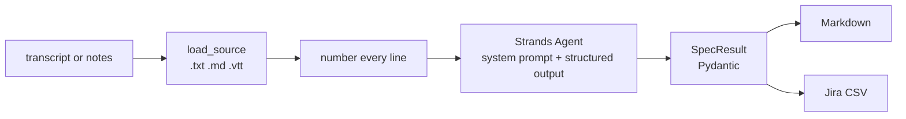

# Forge Spec (Strands, Python)

[](https://github.com/wexlai/forge-agents/actions/workflows/ci.yml)

Turns a meeting transcript, a set of notes or a requirements document into epics, user stories and Given/When/Then acceptance criteria. Built on the [Strands Agents SDK](https://strandsagents.com) for Python. Catalog page: [wexlai.com/forge/forge-spec](https://wexlai.com/forge/forge-spec).

## What it does

Give it a refinement call transcript or your notes. It writes epics and user stories with testable acceptance criteria, and every criterion cites the timestamp or line it came from. Anything the source leaves undecided becomes an open question, and anything it had to assume is listed separately for a person to confirm. Output is Markdown, or a CSV you can import into Jira.

## Quick start

You need [uv](https://docs.astral.sh/uv/) and an API key for one supported provider.

```bash
cp .env.example .env          # add your OPENAI_API_KEY (or switch provider)
uv sync
uv run forge-spec examples/refinement-call.input.txt
```

Write to a file, or produce a Jira CSV:

```bash
uv run forge-spec notes.md --out spec.md
uv run forge-spec call.vtt --format jira-csv --out stories.csv
```

Input can be `.txt`, `.md` or `.vtt` (WebVTT captions from a video call).

## Configuration

Set these in `.env` or in your shell. Shell variables win over `.env`.

| Variable | Default | Meaning |
| --- | --- | --- |
| `MODEL_PROVIDER` | `openai` | `openai`, `anthropic` or `bedrock` |
| `MODEL_ID` | `gpt-5` (OpenAI), `claude-sonnet-5-5` (Anthropic), SDK default (Bedrock) | Which model to call |
| `OPENAI_API_KEY` | | Needed when `MODEL_PROVIDER=openai` |
| `ANTHROPIC_API_KEY` | | Needed when `MODEL_PROVIDER=anthropic` |
| `MAX_TOKENS` | `16000` | Output limit for Anthropic |
| `AWS_REGION` | SDK default | Region for Bedrock; credentials come from the normal AWS chain |

Exit codes: `0` success, `1` the model call failed, `2` bad input file or configuration.

## How it works



1. `inputs.py` reads the file. WebVTT captions become `[hh:mm:ss] Speaker: text` lines.
2. `prompt.py` numbers every line, so the model can cite `line N` when there are no timestamps, and sets the rules: use only what the source says, cite every criterion, keep assumptions separate, name people by role.
3. `agent.py` runs a Strands `Agent` with `structured_output_model=SpecResult`. Strands offers the model a tool shaped like `SpecResult` and validates the answer against the Pydantic model, so a criterion without a source is rejected rather than printed.
4. `render.py` turns the typed result into Markdown (the format on the catalog page) or a Jira CSV with `Issue Id` and `Parent` columns, so stories import under their epic.
5. `providers.py` builds the Strands model for OpenAI, Anthropic or Bedrock from the environment.

Tests replace the model with a stub that answers through the same Strands tool call, so they exercise the real agent loop with no key and no network: `uv run pytest`.

## Examples

| Input | Output |
| --- | --- |
| [refinement-call.input.txt](examples/refinement-call.input.txt) | [refinement-call.output.md](examples/refinement-call.output.md) |

The input is an illustrative refinement call about a FluentEdge feature, written for the catalog page; people are named by role. The output is a real run of this agent with `gpt-5`.

## Limitations

- Reads `.txt`, `.md` and `.vtt` only. Convert `.docx` or `.pdf` to text first.
- Writes Markdown or CSV; it does not create issues in Jira itself.
- One source per run. It does not merge several meetings.
- The model can still misread a discussion. Every criterion carries its source reference so a person can check it quickly; review the open questions and assumptions before sizing.
